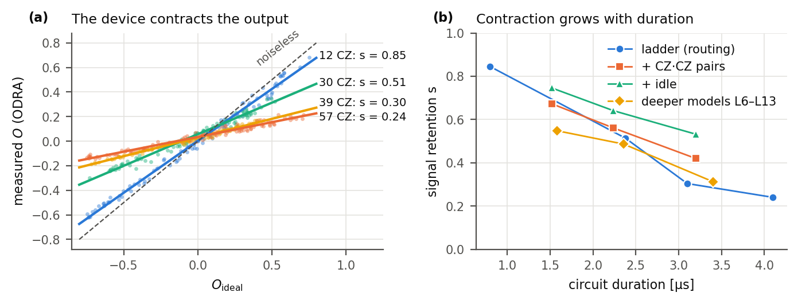
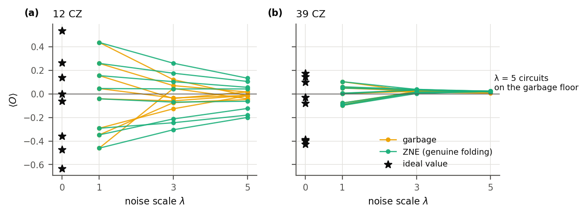
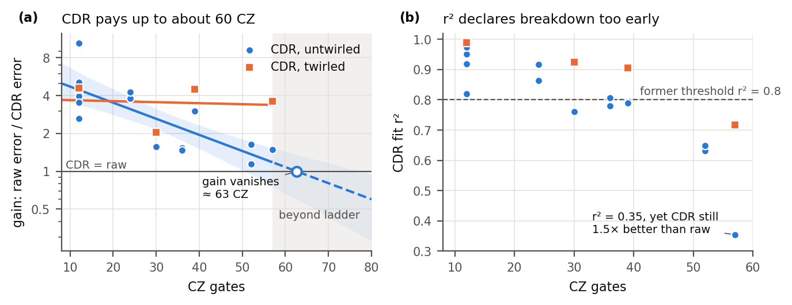
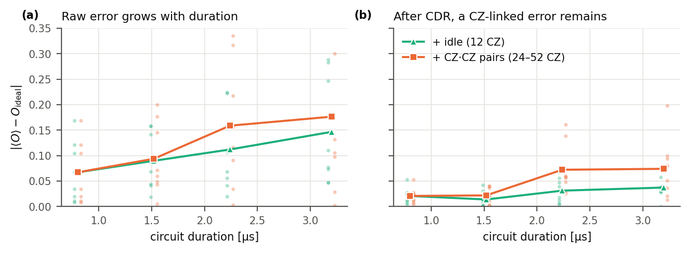
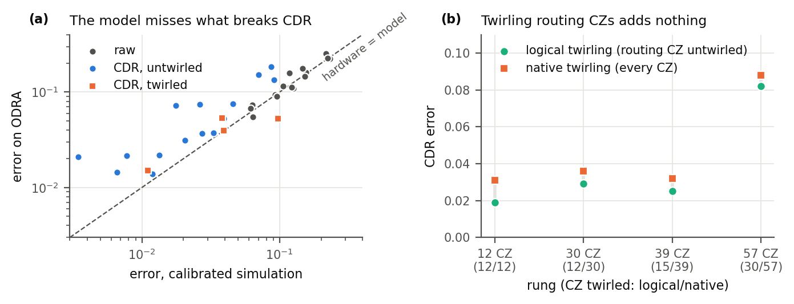
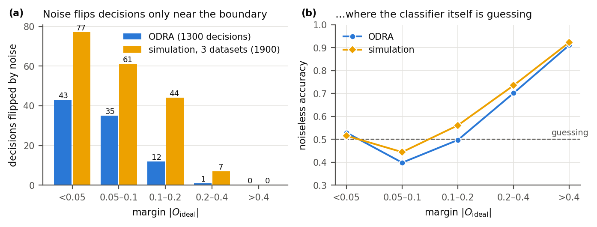

# Szkic artykułu v3 (po polsku, do tłumaczenia na końcu)

Zakres: tylko kampania ODRA + analizy offline. Garnet/Emerald tylko jako wskazówka w Dyskusji.
Nazwy w kodzie: drabina = w01A+w01B, wstawianie = w01P5, vnCDR = w02vn, DD = w03dd, przegląd decyzji = w04m.
Format docelowy: revtex4-2. Wersja sprzed uproszczenia języka: szkic_pl_v1_przed_uproszczeniem.md.
Zasada stylu: krótkie zdania, jedno pojęcie wyjaśnione raz, liczby w tabelach, bez nadęcia.

## Tytuł

Gdzie mitygacja błędów przestaje się opłacać na procesorze z routingiem: pre-rejestrowane
testy sprzętowe, mechanizmy i dlaczego dokładność klasyfikatora się nie zmienia

## Abstrakt

Procesor kwantowy łączy bramką tylko sąsiednie kubity, więc kompilator dokłada bramki, które
niczego nie liczą, ale wnoszą szum. Pytamy, ile takiego narzutu wytrzymuje mitygacja błędów i co daje
ona klasyfikatorowi kwantowemu. Badamy to na pięciokubitowym procesorze IQM ODRA 5. Ten sam
klasyfikator kompilujemy do 12–57 bramek CZ. Każda metoda dostaje tyle samo pomiarów, porównujemy ją
z kontrolą o tym samym koszcie, a testy zapisujemy przed analizą. Wyniki opisuje jeden prosty
obraz: szum ściska wynik ku zeru, a mitygacja działa, dopóki to ściśnięcie jest jedyną szkodą i da się
je zmierzyć. Ekstrapolacja do zerowego szumu (ZNE) działa tylko w najpłytszym obwodzie. Dalej obwody
z wzmocnionym szumem nie niosą już sygnału, a ZNE tylko przeskalowuje wynik. Regresja danych
Clifforda (CDR) opłaca się dłużej, a z twirlingiem Pauliego jej błąd pozostaje niski w całym zakresie.
Standardowa miara jakości CDR ogłasza jednak jej porażkę za wcześnie. Ściśnięcie rośnie głównie z
czasem trwania obwodu. Błąd, który zostaje po CDR, rośnie natomiast z liczbą bramek CZ. Model szumu z
kalibracji go nie widzi, a twirling go usuwa. Dwie metody, które według symulacji lub literatury
powinny pomóc, nie pomogły. Na koniec pokazujemy, że mitygacja zmienia decyzję klasyfikatora tylko
blisko granicy decyzyjnej, gdzie sam klasyfikator zgaduje. Przywraca więc decyzje idealnego obwodu,
ale nie zmienia dokładności.

## 1. Wstęp

**Pytanie.** Klasyfikator kwantowy zwraca decyzję: klasa to znak zmierzonej wartości ⟨O⟩
[schuld2021, perezsalinas2020, bowles2024]. Metody mitygacji błędów ocenia się jednak prawie zawsze
po tym, jak blisko ⟨O⟩ jest wartości idealnej [cai2023]. Prace o uczeniu maszynowym pod szumem pytają
głównie, czy model da się wytrenować [wang2021nibp, wang2024em], jak kodować dane odpornie na szum
[larose2020] albo jak trenować z uwzględnieniem szumu [wang2022qnat]. My zadajemy prostsze pytanie.
Mamy wytrenowany klasyfikator i uruchamiamy go na sprzęcie. Czy mitygacja zmieni jego decyzje? I czy
w ogóle się opłaca przy koszcie, jaki obwód ma po kompilacji?

**Skąd ten koszt.** Na procesorze kubity są połączone tylko z sąsiadami. Gdy obwód potrzebuje bramki
między kubitami, które nie sąsiadują, kompilator wstawia bramki SWAP, a każda to trzy bramki CZ. Te
bramki niczego nie liczą, ale wnoszą szum. Na naszym procesorze ten sam klasyfikator kosztuje od 12
do 57 bramek CZ, zależnie od tego, które kubity ze sobą splata. Teoria mówi, że koszt każdej metody
mitygacji rośnie wykładniczo z głębokością obwodu [takagi2022, quek2024]. Nie mówi jednak, przy ilu
bramkach konkretna metoda przestaje się opłacać na konkretnym urządzeniu.

**Co wiadomo.** W praktyce używa się trzech metod. ZNE mierzy obwód przy celowo wzmocnionym szumie i
ekstrapoluje wynik do zera [temme2017, li2017, kandala2019, giurgica2020]. Köster i Mauerer pokazali,
że gdy obwody z wzmocnionym szumem tracą sygnał, ZNE sprowadza się do przeskalowania jednego pomiaru
[koster2026]. CDR uczy się prostej, która przelicza wynik zaszumiony na idealny. Uczy się jej na
obwodach, których wynik idealny da się policzyć klasycznie [czarnik2021]. Wersja vnCDR dokłada do tego
pomiary przy kilku poziomach szumu [lowe2021]. Twirling Pauliego zamienia część błędów w szum losowy,
z którym metody radzą sobie lepiej [wallman2016, hashim2021, kim2023]. Porównania tych metod pochodzą
jednak głównie z symulacji [lowe2021, bultrini2023]. Testy na sprzęcie albo nie rozdzielają wyników
według głębokości [russo2023], albo sprawdzają ZNE tylko tam, gdzie wynik da się policzyć klasycznie
[kim2023].

**Czego brakuje.** Po pierwsze, pomiaru na sprzęcie: o ile maleje zysk z mitygacji z każdą bramką CZ,
przy tym samym koszcie dla wszystkich metod i z kontrolą, która odróżnia prawdziwą ekstrapolację od
przeskalowania. Po drugie, wyjaśnienia: co dokładnie psuje mitygację i czy model szumu z kalibracji to
przewiduje. Po trzecie, testów zapisanych przed analizą [nosek2018]. Bez nich wynik negatywny trudno
odróżnić od źle dobranej analizy. Po czwarte, sprawdzenia, czy mitygacja zmienia decyzje
klasyfikatora, a nie tylko wartość ⟨O⟩.

**Co robimy.** Używamy pięciokubitowego procesora IQM ODRA 5. Ten sam typ klasyfikatora kompilujemy do
12, 30, 39 i 57 bramek CZ. Porównujemy ZNE, CDR i twirling przy tym samym koszcie, z kontrolą ZNE o tym
samym koszcie, a testy zapisujemy przed analizą. Osobny eksperyment dokłada do obwodu albo pary bramek
CZ, które się znoszą, albo samo czekanie o tej samej długości. Tak rozdzielamy liczbę bramek od czasu
trwania.

**Jeden obraz.** Wszystkie wyniki opisuje jeden prosty model. Szum ściska wynik ku zeru:
zmierzony ≈ s · idealny + c. Liczba s mówi, jaka część wyniku przetrwała szum. Mitygacja działa tak
długo, jak długo to ściśnięcie jest jedyną szkodą i da się je zmierzyć. Wkład pracy:

1. **Decyzje klasyfikatora.** Mitygacja zmienia decyzję tylko blisko granicy decyzyjnej. Tam
   klasyfikator bez szumu ma rację w 44% przypadków (1300 decyzji ze sprzętu). Mitygacja przywraca
   więc decyzje idealnego obwodu, ale nie zmienia dokładności. Podajemy prosty wzór, który mówi, kiedy
   mitygacja poprawi dokładność.
2. **Ściśnięcie.** Mierzymy s na 13 wariantach obwodu. Rośnie ono głównie z czasem trwania obwodu, a
   model szumu z kalibracji przewiduje je prawie dokładnie.
3. **ZNE.** Działa tylko przy 12 CZ. Od 30 CZ tylko przeskalowuje wynik i nie różni się od kontroli.
   Model ściśnięcia przewiduje, o ile ZNE poprawia wynik, bez żadnego dopasowania.
4. **CDR.** Jego przewaga maleje z każdą bramką CZ i znika około 63 CZ. Standardowa miara jakości
   CDR ogłasza porażkę dużo wcześniej. Wyjaśniamy dlaczego.
5. **Co poza ściśnięciem.** Błąd, który zostaje po CDR, rośnie z liczbą bramek CZ, a nie z czasem.
   Model z kalibracji go nie widzi, a twirling go usuwa. Nie jest to prosty błąd pojedynczej bramki.
6. **Wyniki negatywne.** vnCDR, któremu symulacja przewidywała dwukrotną poprawę, i dynamiczne
   odsprzęganie nie pomogły w testach zapisanych przed pomiarem.

Rozdział 2 opisuje eksperymenty. Rozdział 3 przedstawia wyniki według modelu ściśnięcia. Rozdział 4
omawia, co z nich wynika, rozdział 5 ich ograniczenia, a rozdział 6 dalsze kroki.

*Do uzupełnienia w bibliografii:* wang2021nibp (arXiv:2007.14384), wang2024em (Quantum 8, 1287),
larose2020 (PRA 102, 032420), wang2022qnat (arXiv:2110.11331), russo2023 (arXiv:2210.07194),
vovrosh2021, urbanek2021, iqm20bench (arXiv:2508.04483). Pozostałe klucze są w `paper_draft/refs.bib`.

## 2. Metodologia

### 2.1 Urządzenie
IQM ODRA 5 ma pięć kubitów w kształcie gwiazdy: kubit centralny (hub) jest połączony z czterema
pozostałymi. Bramki natywne to obrót jednokubitowy PRX (20 ns) i bramka CZ (60 ns). Czasy życia kubitów
T₁ wynosiły 13–24 µs, a błędy odczytu 0,3–0,8% (0 czytane jako 1) i 2,5–5,1% (1 czytane jako 0). Każda
bramka między kubitami zewnętrznymi musi przejść przez hub, więc koszt routingu rośnie szybko i łatwo
go kontrolować. Dostęp do urządzenia jest nieograniczony.

### 2.2 Klasyfikator i drabina
Klasyfikator rozróżnia dwie klasy zbioru two_curves z biblioteki qml_benchmarks [bowles2024]. Ma 5
kubitów, 3 warstwy i 55 wag. Dane wchodzą jako kąty obrotów, powtarzane w każdej warstwie. Wynik to
średnia ⟨Z⟩ po pięciu kubitach, a decyzja to jej znak. Model trenujemy bez szumu i zamrażamy.

Drabinę tworzą cztery sposoby splatania kubitów. Każdy ma osobno wytrenowany klasyfikator:

| wzorzec | bramki 2q w obwodzie | bramki CZ po kompilacji | dokładność bez szumu |
|---|---|---|---|
| star | 12 | 12 | 0,725 |
| linear | 12 | 30 | 0,692 |
| circular | 15 | 39 | 0,675 |
| all_to_all | 30 | 57 | 0,767 |

Zadanie jest takie samo, zmienia się koszt. Szczeble są jednak różnymi obwodami, a nie tym samym
obwodem w różnych wersjach. Punkty testowe pochodzą z zamrożonego zbioru 100 punktów, zrównoważonego
klasowo. Większość eksperymentów używa 8 z nich: po 2 z każdej ćwiartki marginesu |O_ideal|, czyli
odległości wyniku idealnego od granicy decyzyjnej. Przegląd decyzji używa wszystkich 100.

### 2.3 Kompilacja
Każdy obwód kompilujemy w ten sam sposób: kubit 0 na hubie, stały seed, a sąsiednie obroty
jednokubitowe łączymy w jeden. Obwody pomocnicze CDR i ZNE budujemy na już skompilowanym obwodzie.
Mają więc dokładnie te same bramki CZ w tych samych miejscach co obwód docelowy. Wcześniejsze kampanie
tego nie zapewniały (rozdział 5).

### 2.4 CDR i twirling
**CDR.** Dla każdego punktu budujemy 20 obwodów treningowych. Każdy to obwód docelowy, w którym kąty
obrotów zastępujemy najbliższymi wielokrotnościami π/2, z odrobiną losowości. Takie obwody (obwody
Clifforda) da się szybko symulować klasycznie dla dowolnej liczby kubitów [gottesman1998,
aaronson2004]. Znamy więc ich wynik idealny. Mierzymy je na sprzęcie i dopasowujemy prostą
idealny ≈ a · zmierzony + b. Tę prostą stosujemy do wyniku obwodu docelowego.

**Twirling.** Przed i za każdą bramką CZ dokładamy losową parę bramek Pauliego, które razem nic nie
zmieniają w obwodzie bez szumu. Każde losowanie to jedna ramka. Uśrednienie wyniku po ramkach zamienia
część błędów w szum losowy. Twirling natywny owija każdą fizyczną bramkę CZ. Twirling logiczny owija
tylko bramki z obwodu przed kompilacją, więc bramki CZ dołożone przez routing zostają bez zmian.

**Równy koszt.** Każde ramię dostaje tyle samo pomiarów: 21 obwodów × 6 powtórzeń × 8192 pomiary, czyli
ok. 1 mln na punkt.

| ramię | 6 powtórzeń to | po co |
|---|---|---|
| bez twirlingu | 6 identycznych kopii | kontrola: tyle samo uśredniania, bez twirlingu |
| twirling natywny | 6 ramek, każda bramka CZ | |
| twirling logiczny | 6 ramek, bez bramek z routingu | |
| spread | 120 różnych obwodów treningowych, po 1 ramce | czy lepiej rozłożyć koszt na więcej obwodów |

### 2.5 ZNE i kontrola
ZNE powtarza obwód tak, by szum wzrósł 3 i 5 razy (λ = 3, 5): obwód U zamienia na U(U†U)^k. Z trzech
wyników ekstrapoluje do λ = 0 wzorem Richardsona, bez przycinania wyniku. Każda skala ma 8192 pomiary.

Kontrola **garbage** ma te same bramki CZ w tych samych miejscach, ale losowe obroty: U(V†U)^k. Szum
jest więc taki sam, ale obwody λ = 3 i 5 nie wiedzą nic o prawdziwym wyniku. Jeśli ZNE wypada nie
lepiej niż garbage, jego zysk nie pochodzi z ekstrapolacji [koster2026]. Testowałyśmy też kontrolę
**identity** (pary bramek, które się znoszą), ale okazała się nieważna na sprzęcie (3.2).

Błąd odczytu poprawiamy też osobno, po fakcie, dzieląc przez znane błędy odczytu każdego kubitu. Ta
korekta nie kosztuje pomiarów.

### 2.6 Czas czy bramki: eksperyment wstawiania
Do obwodu z 12 CZ wstawiamy 6, 12 albo 20 dodatkowych elementów. W jednej wersji to pary CZ·CZ, które
się znoszą: obwód liczy to samo, ale ma 24, 36 albo 52 CZ. W drugiej to czekanie o dokładnie tej samej
długości: obwód ma nadal 12 CZ, ale trwa tyle samo. Obwody treningowe CDR dostają te same wstawki. Czas
trwania (0,8–3,2 µs) liczymy z harmonogramu bramek. Błąd opisujemy regresją na liczbę CZ i czas
trwania, z osobnym poziomem dla każdego punktu.

### 2.7 Pozostałe eksperymenty
- **vnCDR** (zapisany przed pomiarem): obwód 12 CZ, 8 punktów. Każdy obwód mierzymy na trzech
  poziomach: bez zmian, z 12 dodatkowymi parami CZ (36 CZ) i z dodatkowym czekaniem. Poziomy mierzymy
  na przemian, więc widzą to samo urządzenie. vnCDR i zwykłe CDR dostają tyle samo pomiarów.
- **DD** (zapisany przed pomiarem): obwody 12 i 39 CZ, CDR bez i z dynamicznym odsprzęganiem (DD)
  producenta. DD wstawia impulsy w czasie, gdy kubit czeka. Oba warianty mierzymy na przemian.
- **Przegląd decyzji:** 13 wariantów obwodu (drabina, wstawianie i głębsze modele) × 100 punktów, tylko
  wynik bez mitygacji. Do tego obwody |00000⟩ i |11111⟩, z których mierzymy błąd odczytu.

### 2.8 Symulator z kalibracji
Model szumu budujemy z danych kalibracyjnych tej samej nocy: czasy życia kubitów, błędy bramek i błędy
odczytu. Symulator przechodzi przez dokładnie ten sam kod co pomiary na sprzęcie. Sprawdzamy też, czy
dodanie do każdej bramki CZ małego, stałego obrotu o kąt θ pozwala odtworzyć sprzęt.

### 2.9 Decyzje
Decyzja to znak wyniku. Liczymy, ile decyzji szum lub mitygacja zmienia, które z tych zmian naprawiają,
a które psują decyzję idealnego obwodu, i jak zmienia się dokładność względem prawdziwych etykiet. Na
sprzęcie używamy przeglądu decyzji (1300 decyzji). W symulacji powtarzamy analizę dla trzech zbiorów
danych z qml_benchmarks: two_curves, linearly_separable i hidden_manifold.

### 2.10 Statystyka i zapis przed analizą
Główna miara to błąd jednego punktu: |wynik po mitygacji − wynik idealny|. Metody porównujemy parami na
tych samych punktach testem Wilcoxona [wilcoxon1945] i średnią geometryczną ilorazu błędów.

Plan analizy i jego kod zapisałyśmy w gicie (tag prereg-v1), zanim policzyłyśmy jakikolwiek błąd, ale
już po rozpoczęciu pomiarów drabiny [nosek2018]. Główne hipotezy to: twirling obniża błąd CDR (H1),
twirling natywny jest nie gorszy od logicznego (H3), spread bije twirling (H6), więcej CZ przy tym samym
czasie zwiększa błąd (H7a) i dłuższy czas przy tych samych bramkach zwiększa błąd (H7b). Poprawiamy je
na wielokrotne testowanie metodą Holma [holm1979]. Dodatkowo zapisałyśmy kryterium dla ZNE (H4) i test
decyzji (H5) [mcnemar1947]. Eksperymenty vnCDR i DD mają po jednej hipotezie, zapisanej przed pomiarem
(tagi prereg-vn1 i prereg-dd1).

Wszystko inne to analizy dodatkowe. Oznaczamy je gwiazdką (*), a ich wartości p nie są poprawiane.

## 3. Wyniki

**Model.** Wyniki układamy według jednego przybliżonego modelu. Dla danego obwodu i wejścia x

  zmierzony(x) = s · idealny(x) + c + r(x).

Liczba **s** (retencja sygnału) mówi, jaka część wyniku przetrwała szum. Jest taka sama dla wszystkich
wejść i dla obwodów o tych samych bramkach. Liczba **c** to małe przesunięcie, głównie od błędu
odczytu. **r(x)** to reszta: wszystko, czego prosta nie opisuje. Część s · idealny + c nazywamy
**ściśnięciem**. Szum miesza stan z losowym, a dla stanu losowego ⟨Z⟩ = 0, więc wynik maleje ku zeru.

Gdyby reszta była zerowa, mitygacja byłaby prosta: idealny = (zmierzony − c) / s. Każda metoda to wtedy
inny sposób oszacowania s i c. Że szum przeskalowuje wynik, jest znane [vovrosh2021, urbanek2021], a
prosta jest podstawą CDR [czarnik2021]. Pokazujemy, że ten jeden model wyjaśnia, gdzie i dlaczego
zawodzą ZNE, CDR i mitygacja decyzji.

Kolejno sprawdzamy: ile wynosi ściśnięcie (3.1), czego potrzebuje od niego ZNE (3.2), jak długo CDR
może się go uczyć (3.3), co zostaje poza nim (3.4), jak twirling to naprawia (3.5), czy dodatkowe
pomiary szumu pomagają (3.6) i co ściśnięcie znaczy dla decyzji (3.7).

### 3.1 Szum ściska wynik, a ściśnięcie rośnie z czasem

Na każdym wariancie obwodu 100 punktów przeglądu decyzji leży na prostej (Rys. 1a). Jej nachylenie s
spada z 0,85 przy 12 CZ do 0,24 przy 57 CZ (Tabela 1). Przesunięcie jest małe: odczyt dodaje ok.
+0,03 i ściska wynik o 4%.

**Tabela 1.** Retencja sygnału s na drabinie (przegląd decyzji, 100 punktów)*.

| CZ | 12 | 30 | 39 | 57 |
|---|---|---|---|---|
| s | 0,85 | 0,51 | 0,30 | 0,24 |

**Ściśnięcie zależy głównie od czasu trwania obwodu** (Rys. 1b). Na 13 wariantach sam czas trwania
wyjaśnia 81% zmian s, a liczba bramek CZ 74%*. Przy tym samym czasie pary CZ ściskają wynik trochę
mocniej niż czekanie (s = 0,67 / 0,56 / 0,42 wobec 0,75 / 0,64 / 0,53). Bramki CZ dokładają więc swoje,
ale główną rolę gra czas.

To samo pokazuje test zapisany przed analizą. Przy tych samych bramkach każda mikrosekunda zwiększa
błąd wyniku bez mitygacji 1,43 raza (H7b, Tabela 5). To jedyna nasza hipoteza potwierdzona po poprawce
na wielokrotne testowanie. Wpływ samych bramek CZ przy tym samym czasie pozostaje nierozstrzygnięty
(H7a).

**Ściśnięcie da się przewidzieć.** Symulator z kalibracji odtwarza błąd bez mitygacji: sprzęt daje
błąd 1,04 raza większy niż model. Na 1300 wartościach z przeglądu decyzji korelacja wynosi 0,984, a
decyzja jest ta sama w 93% przypadków* (Rys. 5a, szare punkty).

**Rys. 1.** (a) Wynik zmierzony na ODRZE wobec idealnego, 100 punktów na każdym z czterech szczebli
drabiny. Linie to dopasowane proste, s to ich nachylenie. (b) Retencja s wobec czasu trwania obwodu
dla 13 wariantów: drabina, obwód 12 CZ z dodanymi parami CZ, ten sam obwód z dodanym czekaniem i
głębsze modele.

### 3.2 ZNE potrzebuje sygnału w obwodach z wzmocnionym szumem

ZNE mierzy obwód przy szumie 3 i 5 razy większym. Jeśli każde powtórzenie ściska wynik tak samo,
retencja wynosi wtedy s³ i s⁵. Przy 12 CZ to 0,61 i 0,44: sygnał jeszcze jest. Przy 39 CZ to 0,03 i
0,002: sygnału praktycznie nie ma.

**Tabela 2.** Średni błąd na drabinie.

| CZ | bez mitygacji | ZNE | kontrola garbage | CDR z twirlingiem |
|---|---|---|---|---|
| 12 | 0,074 | 0,045 | 0,137 | 0,015 |
| 30 | 0,110 | 0,064 | 0,068 | 0,053 |
| 39 | 0,161 | 0,112 | 0,103 | 0,040 |
| 57 | 0,223 | 0,170 | 0,161 | 0,053 |

**Przy 12 CZ** ZNE naprawdę ekstrapoluje. Bije kontrolę w 7 z 8 punktów (p = 0,012), a jego wyniki
przy rosnącym λ wskazują kierunek wyniku idealnego (Rys. 2a). Nie bije jednak wyniku bez mitygacji
(p = 0,47). Powód: ZNE wzmacnia szum bramek, ale nie odczytu, więc błędu odczytu nie usuwa. Po
korekcie odczytu błąd ZNE spada do 0,016*.

**Od 30 CZ** ZNE daje to samo co kontrola (Tabela 2). Przy 39 CZ jest od niej lepsze tylko w 2 z 8
punktów (p = 0,84). Rys. 2b pokazuje dlaczego. Przy λ = 5 wszystkie punkty dają ten sam wynik, choć ich
wartości idealne leżą od −0,43 do +0,17. Obwód „zapomniał”, co liczył. Wtedy wzór Richardsona
sprowadza się do 15/8 · wynik − 7/8 · tło [koster2026], czyli do pomnożenia wyniku przez ok. 1,9. To
częściowo odwraca ściśnięcie, więc ZNE bije wynik bez mitygacji (8 z 8 punktów przy 39 CZ). Ale
kontrola, która nie wie nic o wyniku, robi dokładnie to samo. Kryterium ZNE zapisane przed analizą (H4)
nie jest spełnione na żadnym szczeblu.

**Model przewiduje, o ile ZNE poprawia wynik.** Przy retencji s^λ wzór Richardsona daje g(s) · idealny,
gdzie g(s) = 15/8 · s − 5/4 · s³ + 3/8 · s⁵. Stosunek błędu ZNE do błędu bez mitygacji wynosi wtedy
|1 − g(s)| / (1 − s). Wstawiamy s zmierzone osobno, bez żadnego dopasowania (Tabela 3)*. Przy 39 i 57 CZ
przewidywanie zgadza się z pomiarem. Przy 12 i 30 CZ wynik jest gorszy od przewidywanego, bo tam
dominuje błąd odczytu, którego model z c = 0 nie zawiera. ZNE przy 39 CZ mnoży wynik przez ok. 1,9,
a żeby odwrócić ściśnięcie, trzeba by przez 1/s ≈ 3,3.

**Tabela 3.** Stosunek błędu ZNE do błędu bez mitygacji: przewidywanie z modelu i pomiar*.

| CZ | s | przewidywany | zmierzony |
|---|---|---|---|
| 12 | 0,85 | 0,05 | 0,61 (po korekcie odczytu 0,22) |
| 30 | 0,51 | 0,40 | 0,58 |
| 39 | 0,30 | 0,67 | 0,70 |
| 57 | 0,24 | 0,75 | 0,76 |

**Czy dało się to zauważyć bez kontroli?** Diagnostyki zapisane przed analizą tego nie wykryły:
stosunek sygnału do szumu liczony względem zera wynosił przy 39 CZ 4,1, powyżej progu 2. Zapaść widać
dopiero, gdy ten stosunek liczymy względem tła kontroli (0,8 przy 39 CZ wobec 11,8 przy 12 CZ).
Kontrola identity okazała się nieważna na sprzęcie: jej wynik dryfuje ku +1, bo kubity w czasie
obwodu wracają do stanu |0⟩ (relaksacja T₁). Symulator odtwarza ten dryf, a przy T₁ → ∞ dryf znika.

**Rys. 2.** Wynik ⟨O⟩ przy rosnącym wzmocnieniu szumu λ dla 8 punktów: ZNE i kontrola garbage o tych
samych bramkach CZ. Gwiazdki to wartości idealne. (a) 12 CZ. (b) 39 CZ: przy λ = 3 i 5 oba warianty
dają to samo.

### 3.3 CDR uczy się prostej i działa, dopóki prosta jest prawdziwa

CDR robi wprost to, co pokazuje Rys. 1: uczy się prostej na obwodach o tych samych bramkach i odwraca
ją. Nie potrzebuje sygnału przy wzmocnionym szumie. Potrzebuje tylko, żeby prosta była prawdziwa.

**Tabela 4.** CDR bez twirlingu i z twirlingiem.

| CZ | bez mitygacji | CDR | ile razy lepszy | lepszy w | r² bez twirlingu | r² z twirlingiem |
|---|---|---|---|---|---|---|
| 12 | 0,074 | 0,022 | 5,1 | 6/8 | 0,97 | 0,99 |
| 30 | 0,110 | 0,076 | 1,6 | 6/8 | 0,76 | 0,92 |
| 39 | 0,161 | 0,053 | 3,0 | 7/8 | 0,79 | 0,90 |
| 57 | 0,223 | 0,152 | 1,5 | 5/8 | 0,35 | 0,72 |

CDR bez twirlingu bije wynik bez mitygacji na każdym szczeblu. Jego przewaga maleje jednak o ok. 25% z
każdymi 10 bramkami CZ (15 wariantów obwodu, Rys. 3a)*. Z tej zależności przewaga znika przy około
63 CZ (95% przedział: 50–79 CZ), tuż za końcem drabiny. To ekstrapolacja, nie pomiar.

**Miara jakości ogłasza porażkę za wcześnie.** CDR ocenia się zwykle przez r², czyli to, jak dobrze
prosta pasuje do obwodów treningowych. Przy 57 CZ r² wynosi 0,35, a CDR wciąż jest 1,5 raza lepszy od
wyniku bez mitygacji (Rys. 3b). Próg r² = 0,8, którego używałyśmy wcześniej, uznałby CDR za zepsuty
już przy ok. 30 CZ.

Model wyjaśnia dlaczego:

  r² ≈ s² · Var(idealny) / (s² · Var(idealny) + Var(r) + szum pomiaru).

Gdy s maleje, r² spada, nawet jeśli reszta r się nie zmienia. Sygnał robi się po prostu mały względem
szumu, a prosta wciąż jest średnio dobra. Do tego przy 39 CZ większość obwodów treningowych (78–85%)
ma wynik idealny 0, co jeszcze obniża r². r² miesza więc dwie rzeczy: „sygnał się skurczył” i „prosta
przestała pasować”. Lepsze kryterium jest proste: CDR przestaje się opłacać, gdy nie bije wyniku bez
mitygacji albo kontroli o tym samym koszcie.

**Czy CDR może ocenić własny błąd?** Błąd liczony na obwodach treningowych, gdy jeden z nich pomijamy
(walidacja krzyżowa), dobrze przewiduje średni błąd CDR na szczeblu (mediana stosunku 1,02)*. Jako
przedział błędu bez twirlingu jest trafny w 72% (1σ) i 91% (2σ) przypadków. Nie warto go jednak
używać do decydowania, czy włączyć CDR: „zawsze CDR” wybiera lepiej (81% wobec 72%).

Spadek r² mówi, że oprócz ściśnięcia coś jeszcze rośnie z kosztem. To sprawdzamy dalej.

**Rys. 3.** (a) Ile razy CDR jest lepszy od wyniku bez mitygacji, wobec liczby bramek CZ (skala
logarytmiczna). Linia ciągła to dopasowanie z 95% pasmem, linia przerywana to ekstrapolacja, kółko to
punkt, w którym przewaga znika. (b) r² dopasowania CDR na tych samych szczeblach. Linia przerywana to
dawny próg 0,8.

### 3.4 Co zostaje poza ściśnięciem

**Eksperyment wstawiania** rozdziela czas i bramki na tym samym obwodzie (Rys. 4, Tabela 5). Błąd bez
mitygacji rośnie podobnie przy parach CZ i przy czekaniu, zgodnie z 3.1. Po CDR jest inaczej. Czekanie
prawie nie zostawia błędu (0,014–0,037), a pary CZ tak (0,072–0,074 przy 36 i 52 CZ). Błąd po CDR
rośnie o 34% z każdymi 10 bramkami CZ, a z czasem nie rośnie istotnie.

Wyjaśnienie jest proste. Ściśnięcie od czasu jest takie samo w obwodach treningowych i w obwodzie
docelowym, więc prosta CDR je uczy. Część błędu od bramek CZ przenosi się z obwodów treningowych na
docelowy gorzej. Wyniki się nie zmieniają, gdy usuniemy warianty, w których zmieniła się kalibracja.

**Tabela 5.** Regresja eksperymentu wstawiania (56 pomiarów, 8 punktów). Pierwsze p z testu t,
drugie z dokładnego bootstrapu.

| błąd | co dodajemy | mnożnik | 95% przedział | p (t) | p (bootstrap) |
|---|---|---|---|---|---|
| bez mitygacji | +10 CZ, ten sam czas | 0,96 | 0,74–1,24 | 0,69 | 0,68 |
| bez mitygacji | +1 µs, te same bramki | **1,43** | 1,27–1,61 | 0,0002 | 0,008 |
| po CDR | +10 CZ | **1,34** | 1,07–1,67 | 0,018 | 0,016 |
| po CDR | +1 µs | 1,32 | 0,69–2,53 | 0,35 | 0,31 |

**Model z kalibracji tej reszty nie widzi.** Ten sam symulator, który dobrze przewiduje wynik bez
mitygacji, zaniża błąd CDR bez twirlingu prawie dwa razy (Tabela 6, Rys. 5a)*. Nadwyżka sprzętu nad
modelem pojawia się przy parach CZ (+0,037), a przy czekaniu prawie nie (+0,006, p = 0,0003)*.

**To nie jest prosty błąd bramki CZ.** Gdyby każda bramka CZ obracała stan o mały stały kąt θ, model z
takim kątem powinien odtworzyć sprzęt. Nie odtwarza go dla żadnego θ do 0,15. Przy 57 CZ przewiduje
r² = 0,89–0,94, a sprzęt daje 0,66. Większe θ psują za to szczeble, które pasowały.

**Tabela 6.** Ile razy błąd na ODRZE jest większy niż w symulacji z kalibracji*.

| błąd | sprzęt / model |
|---|---|
| bez mitygacji | 1,04 |
| CDR bez twirlingu | 1,88 |
| CDR z twirlingiem | 0,86 |

**Rys. 4.** Eksperyment wstawiania: obwód 12 CZ z dodanymi parami CZ albo czekaniem o tej samej
długości, wobec czasu trwania. (a) Błąd bez mitygacji. (b) Błąd po CDR. Linie łączą średnie, jasne
punkty to pojedyncze punkty testowe.

### 3.5 Twirling przywraca prostą

Z twirlingiem błąd CDR wynosi 0,015 / 0,053 / 0,040 / 0,053 przy 12 / 30 / 39 / 57 CZ. Przewaga nad
wynikiem bez mitygacji trzyma się na poziomie 3,6–4,6 raza i nie maleje z liczbą bramek (Rys. 3a). r²
rośnie (przy 57 CZ z 0,35 do 0,72), a model z kalibracji znów zgadza się ze sprzętem (Tabela 6).
Twirling przywraca więc dokładnie to, czego potrzebuje CDR: prostą.

**Test zapisany przed analizą tego nie potwierdził.** Twirling obniżył błąd CDR w 20 z 32 par
(p = 0,09, po poprawce Holma 0,37), choć średnia jest niższa na każdym szczeblu. Są dwa powody. Przy
płytkich obwodach zysk jest mały. A wynik zmienia się między ramkami twirlingu 10–30 razy bardziej,
niż wynikałoby z samego szumu pomiaru*. Przy 6 ramkach to ok. połowa błędu CDR z twirlingiem przy
12 CZ. Twirling ogranicza więc liczba ramek, a nie liczba pomiarów.

**Twirlowanie bramek z routingu nic nie daje*** (Tabela 7, Rys. 5b). Twirling natywny owija wszystkie
bramki CZ, a logiczny pomija te dołożone przez routing. Przy 30 CZ natywny owija 30 bramek, a logiczny
tylko 12. Gdyby reszta r była błędem pojedynczych bramek CZ, natywny powinien wyraźnie wygrywać. Nie
wygrywa. Przy 12 CZ, gdzie oba robią fizycznie to samo, różnią się o 49%. Na pozostałych szczeblach
różnice są mniejsze. Wariancja między ramkami jest w obu wariantach taka sama, więc to też nie kwestia
szumu losowania. (Test zapisany przed analizą, H3, nie daje się zinterpretować, bo oba warianty
używały tego samego zestawu obwodów treningowych dla wszystkich punktów.)

**Tabela 7.** Twirling natywny a logiczny*.

| CZ | bramki owinięte: logiczny / natywny | błąd: logiczny | błąd: natywny |
|---|---|---|---|
| 12 | 12 / 12 | 0,019 | 0,031 |
| 30 | 12 / 30 | 0,029 | 0,036 |
| 39 | 15 / 39 | 0,025 | 0,032 |
| 57 | 30 / 57 | 0,082 | 0,088 |

Trzy niezależne obserwacje mówią więc to samo. Reszta r jest związana z bramkami CZ i z routingiem,
ale nie jest stałym błędem pojedynczej bramki. Rozłożenie kosztu na więcej obwodów treningowych zamiast
ramek (spread, H6) też nie pomaga (p = 0,55).

**Rys. 5.** (a) Błąd na ODRZE wobec błędu w symulacji z kalibracji tej samej nocy, dla każdego
szczebla i metody. Linia przerywana oznacza zgodność. (b) Błąd CDR z twirlingiem logicznym i
natywnym na szczeblach drabiny.

### 3.6 Więcej pomiarów szumu nie pomaga

Skoro prosta działa, kusi, żeby dać metodzie więcej informacji o szumie. Sprawdziłyśmy to dwoma
eksperymentami zapisanymi przed pomiarem. Oba dały wynik negatywny.

**vnCDR** mierzy każdy obwód treningowy także przy dodanych parach CZ i przy dodanym czekaniu. Przy
tej samej liczbie pomiarów nie jest lepszy od CDR: błąd 0,017 wobec 0,015, lepszy w 4 z 8 punktów,
p = 0,63. Symulacja tego samego eksperymentu przewidywała, że vnCDR zmniejszy błąd o połowę. Żaden z
wariantów dodatkowych nie pomógł. Model wyjaśnia dlaczego: poziom z dodanymi parami ma 36 CZ, gdzie
s ≈ 0,5, więc dodatkowy pomiar niesie mało sygnału, a parametrów do dopasowania jest więcej. Jeden z 8
punktów zmierzono trzy dni wcześniej, przy innej kalibracji. Poziomy w tym punkcie mierzono jednak na
przemian, więc porównanie jest uczciwe.

**DD** dokłada impulsy w czasie czekania. CDR z DD ma błąd 0,115, a bez DD 0,063. DD było lepsze w 4 z
16 par, p = 0,065. Zgodnie z planem werdykt brzmi: nie wykryto różnicy. Kierunek jest jednak wyraźny.
DD pogarsza wynik bez mitygacji przy 12 CZ w 8 z 8 punktów (0,047 → 0,125)* i obniża r² CDR na obu
szczeblach (0,97 → 0,87 i 0,62 → 0,34)*. DD psuje więc prostą, której potrzebuje CDR. Oba warianty
mierzyłyśmy na przemian przy jednej kalibracji, więc dryf urządzenia tego nie tłumaczy.

### 3.7 Decyzje klasyfikatora

Model ma prostą konsekwencję dla klasyfikatora. Decyzja to znak wyniku. Ściśnięcie nie zmienia znaku,
więc szum zmienia decyzję tylko punktom, których wynik idealny jest bliski zera, czyli blisko granicy:
|idealny| < |c| / s. Mitygacja liniowa (a · zmierzony + b) też tylko przesuwa próg decyzji z 0 do
−b/a. Dotyczy to CDR, korekty odczytu i ZNE, gdy staje się przeskalowaniem. Mitygacja może więc
zmienić decyzję tylko blisko granicy.

**Ile zmienia się dokładność.** Gdy mitygacja zmienia decyzję, rację ma dokładnie jedna z dwóch
decyzji: przed albo po. Stąd dokładny wzór

  zmiana dokładności = (odsetek zmienionych decyzji) · (2q − 1),

gdzie q to odsetek zmienionych decyzji, w których rację ma mitygacja. Gdy mitygacja przywraca decyzję
idealnego obwodu, q to dokładność klasyfikatora bez szumu blisko granicy. Mitygacja poprawi więc
dokładność tylko wtedy, gdy klasyfikator bez szumu ma tam rację wyraźnie częściej niż co drugi raz.

**Dane.** Na sprzęcie szum zmienił 91 z 1300 decyzji (7%). Zmienione punkty leżą blisko granicy:
mediana |idealny| to 0,053, a dla wszystkich punktów 0,331 (Rys. 6a). W tych punktach klasyfikator bez
szumu ma rację tylko w 44% przypadków (40 z 91; Rys. 6b). Szum nie obniżył więc dokładności: 0,720 bez
mitygacji wobec 0,712 dla obwodu idealnego.

W symulacji na trzech zbiorach danych CDR przywraca decyzję idealnego obwodu: naprawia 132 decyzje, a
psuje 32 (p = 1,3·10⁻¹⁵)*. Dokładność się jednak nie zmienia: 0,735 bez mitygacji, 0,727 po CDR, 0,731
dla obwodu idealnego. Zgadza się to ze wzorem: CDR zmienił 164 decyzje i miał rację w 74 z nich
(q = 0,45), co daje zmianę −0,008. Dokładność klasyfikatora bez szumu rośnie z odległością od granicy
(Tabela 8), a szum zmienia decyzje tylko tam, gdzie wynosi ona ok. 0,5. Test zapisany przed analizą
(H5) miał tylko 32 punkty i za małą moc, ale jest zgodny z tym obrazem.

**Tabela 8.** Dokładność klasyfikatora bez szumu i liczba decyzji zmienionych przez szum, według
odległości od granicy (symulacja, 1900 decyzji)*.

| \|idealny\| | < 0,05 | 0,05–0,10 | 0,10–0,20 | 0,20–0,40 | > 0,40 |
|---|---|---|---|---|---|
| dokładność bez szumu | 0,52 | 0,44 | 0,56 | 0,74 | 0,92 |
| decyzje zmienione | 77 | 61 | 44 | 7 | 0 |

**Rys. 6.** (a) Liczba decyzji zmienionych przez szum według odległości od granicy: ODRA (1300
decyzji) i symulacja (trzy zbiory danych). (b) Dokładność klasyfikatora bez szumu w tych samych
przedziałach. Linia przerywana to zgadywanie.

## 4. Dyskusja

### 4.1 Jeden model zamiast listy porażek
Bez modelu nasze wyniki byłyby listą: ZNE nie działa, r² spada, twirling pomaga, DD szkodzi,
dokładność się nie zmienia. Z modelem to trzy skutki jednej rzeczy. ZNE zawodzi, gdy s³ i s⁵ są za małe,
żeby je zmierzyć, i model przewiduje wtedy jego wynik. r² spada, bo maleje s, nawet gdy prosta wciąż
działa. Dokładność się nie zmienia, bo ściśnięcie nie zmienia znaku. Wszystko to da się sprawdzić z
góry, mierząc jedną liczbę: s.

### 4.2 Liczba bramek CZ to nie cała historia
Koszt obwodu zwykle mierzy się liczbą bramek dwukubitowych. U nas ta liczba miesza dwie różne rzeczy.
Ściśnięcie, które mitygacja umie odwrócić, rośnie głównie z czasem trwania obwodu. Reszta, której
mitygacja nie umie odwrócić, rośnie z liczbą bramek CZ. Dlatego ta sama liczba bramek może oznaczać
różny koszt. Starsze, mniej staranne pomiary na dwóch większych procesorach IQM (Garnet, 20 kubitów, i
Emerald, 54 kubity) pokazały ten sam kształt spadku jakości CDR, ale przy ok. trzy razy większej liczbie
bramek. Te pomiary nie spełniały jednak warunków tej pracy, więc traktujemy je tylko jako wskazówkę.
Wniosek praktyczny: podawać czas trwania obwodu obok liczby bramek, a progi opłacalności mierzyć na
konkretnym urządzeniu.

### 4.3 Czym jest reszta
O reszcie r wiemy cztery rzeczy: rośnie z liczbą bramek CZ, model z kalibracji jej nie ma, twirling ją
usuwa i nie jest stałym błędem pojedynczej bramki. Pasują do tego mechanizmy, które działają mocniej w
obwodach z routingiem. Przykłady: wpływ wykonywanej bramki na sąsiednie, czekające kubity (przy
routingu przez hub takich sytuacji jest więcej), ucieczka kubitu poza stany 0 i 1, błędy powiązane
między trzema bramkami jednego SWAP oraz dryf urządzenia między kalibracją a pomiarem. Podobne
przyczyny wskazano dla 20-kubitowego procesora IQM [iqm20bench]. Nie rozstrzygamy, który mechanizm
dominuje. Testy proponujemy w rozdziale 6.

### 4.4 Co to znaczy dla uczenia maszynowego
Wzór na zmianę dokładności zmienia pytanie. Nie „czy ta metoda jest dobra”, tylko „czy mój
klasyfikator ma rację blisko granicy”. Zwykle nie ma, bo punkty blisko granicy to właśnie te, które
rozróżnia najgorzej. Mitygacja może pomóc, gdy szum jest tak silny, że zmienia decyzje punktów, które
klasyfikator rozpoznaje pewnie. Zgadza się to z naszymi wcześniejszymi obserwacjami na zbiorze
Banknote: tam mitygacja podniosła dokładność dopiero przy dużym koszcie routingu. Wnioski dla
praktyka są dwa. Przy klasyfikacji lepiej poprawić margines klasyfikatora, np. przez kodowanie
odporne na szum [larose2020], niż mitygować. Mitygacja ma sens tam, gdzie liczy się sama wartość:
prawdopodobieństwo, pewność predykcji, wartość jądra kwantowego albo energia.

### 4.5 Prosta reguła
1. Zmierz s dla swojego obwodu. Wystarczy kilka obwodów Clifforda o tych samych bramkach albo
   symulator z kalibracji.
2. Używaj ZNE tylko wtedy, gdy s³ (i s⁵, jeśli używasz λ = 5) jest wyraźnie większe od szumu pomiaru.
   Inaczej ZNE tylko przeskalowuje wynik.
3. Przy większym koszcie używaj CDR z twirlingiem. Oceniaj go porównaniem z wynikiem bez mitygacji
   albo z kontrolą, a nie progiem na r².
4. Nie dokładaj pomiarów szumu ani DD w ciemno. U nas nie pomogły.
5. Przy klasyfikacji najpierw sprawdź, czy klasyfikator bez szumu ma rację blisko granicy.

### 4.6 Dlaczego wyniki negatywne coś znaczą
Trzy nasze główne wyniki są negatywne: ZNE od 30 CZ, vnCDR i DD. Każdy z nich coś znaczy, z czterech
powodów. Testy zapisałyśmy przed analizą. Ta sama analiza wykrywa efekty, gdy one są: CDR bije wynik
bez mitygacji w 27 z 32 par z twirlingiem, a wpływ czasu trwania ma p rzędu 10⁻⁴. Kontrola garbage
pokazuje, że zysk ZNE jest pozorny. A symulacja przewidywała, że vnCDR pomoże, i na sprzęcie nie
pomógł. Model mówi przy tym, dlaczego każdy z tych wyników jest negatywny. Jedyny słaby wynik to
twirling: wyraźna tendencja, ale za mało punktów i ramek, żeby ją potwierdzić albo wykluczyć.

## 5. Ograniczenia

- **Jedno urządzenie.** Wszystko zmierzyłyśmy na pięciokubitowej gwieździe. Nie wiemy, czy podział
  „czas → ściśnięcie, bramki CZ → reszta” działa na innych topologiach.
- **Mało punktów.** Główne porównania mają 8 punktów na szczebel, tych samych we wszystkich
  eksperymentach. Przegląd decyzji ma 100 punktów, ale tych samych na 13 wariantach obwodu.
- **Szczeble drabiny to różne obwody.** Liczba bramek jest tam powiązana z funkcją obwodu. Eksperyment
  wstawiania to rozdziela, ale tylko dla jednego obwodu.
- **Kalibracja.** W trakcie pomiaru szczebli 30 i 57 CZ zmieniła się kalibracja, a część pomiarów
  przeplatała się z przeglądem decyzji. W eksperymencie wstawiania zmiana dotknęła dwóch wariantów.
  Rejestrujemy zmianę kalibracji, ale nie dryf między kalibracjami. Analizę wrażliwości dla 57 CZ trzeba
  jeszcze zrobić.
- **Zapis przed analizą, ale po starcie pomiarów.** Plan analizy drabiny zapisałyśmy przed policzeniem
  błędów, ale po rozpoczęciu pomiarów. Hipotezy opierały się na pomiarach próbnych. Wiele analiz to
  analizy dodatkowe.
- **Model jest przybliżony.** Zakłada to samo s dla wszystkich wejść, stałe c i retencję s^λ przy
  wzmocnieniu szumu. Czasy trwania liczymy z harmonogramu, a nie mierzymy.
- **Dopasowanie kąta θ** zrobiłyśmy na starszych pomiarach twirlingu z września, a nie na danych z tej
  pracy.
- **Zakres metod.** ZNE tylko ze wzorem Richardsona i skalami 1, 3, 5. DD tylko w wersji producenta.
  Nie badałyśmy PEC.
- **Symulacja decyzji** używa modelu, który nie zawiera reszty r, więc CDR wypada w niej za dobrze.
  Najważniejszy fakt, dokładność klasyfikatora bez szumu blisko granicy, pochodzi jednak ze sprzętu.
- **Mało ramek twirlingu** (6) osłabia test twirlingu.

## 6. Dalsze prace

- Wydłużyć drabinę poza 57 CZ i zmierzyć, a nie wyliczyć, gdzie CDR przestaje się opłacać.
- Powtórzyć ten sam protokół na większych procesorach z inną topologią.
- Zidentyfikować resztę r: pomiary wpływu bramki na sąsiednie kubity, wykrywanie ucieczki z
  podprzestrzeni, pary CZ wstawiane na krawędziach z różną liczbą sąsiadów, twirling tylko bramek z
  routingu.
- Sprawdzić najtańszą mitygację: skoro symulator z kalibracji przewiduje s, można podzielić wynik przez
  przewidziane s bez żadnych dodatkowych pomiarów i porównać to z CDR. Podobnie ZNE ze skalami
  dobranymi tak, żeby s^λ pozostało mierzalne.
- Twirling z większą liczbą ramek i przedziały błędu CDR, które uwzględniają różnice między ramkami.
- Sprawdzić wzór na zmianę dokładności na klasyfikatorach z dużym marginesem i na zadaniach, w
  których liczy się wartość.
- Wszystkie te testy zapisać przed pomiarem.
