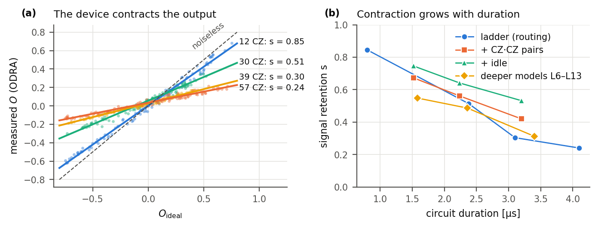
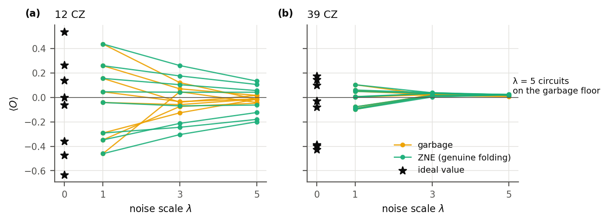
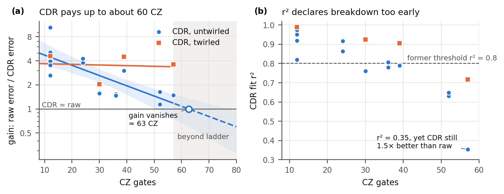
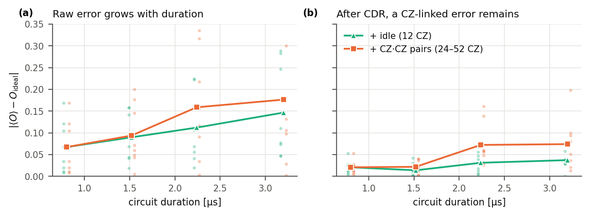
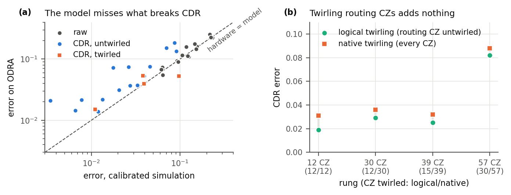
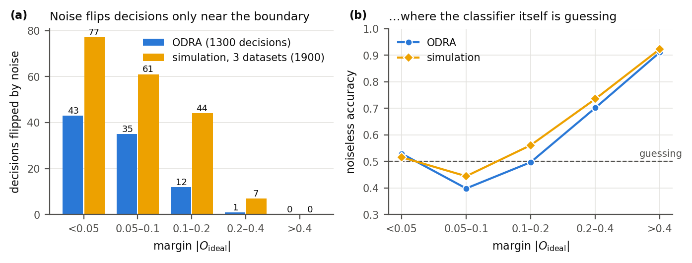

# Szkic artykułu v3 (po polsku, do tłumaczenia na końcu)

Zakres: tylko kampania ODRA (eksperyment drabiny, eksperyment wstawiania, eksperyment vnCDR, eksperyment DD, przegląd decyzji) + analizy offline.
Nazwy w kodzie: drabina = w01A+w01B, wstawianie = w01P5, vnCDR = w02vn, DD = w03dd, przegląd decyzji = w04m.
Garnet/Emerald tylko jako kontekst w Dyskusji i w Limitations (stary potok).
Format docelowy: revtex4-2 (PRA / PR Research). Plik docelowy: paper_draft/v3/main.tex.

## Tytuł

Gdzie mitygacja błędów przestaje się opłacać na procesorze z routingiem: pre-rejestrowane
testy sprzętowe, mechanizmy i dlaczego dokładność klasyfikatora się nie zmienia

## Abstrakt (v4, krótszy)

Routing na sprzęcie o rzadkiej łączności dokłada bramki dwukubitowe, które niczego nie liczą,
ale wnoszą szum. Ile tego narzutu potrafi wchłonąć mitygacja błędów i co daje ona klasyfikatorowi
kwantowemu? Sprawdzamy to na pięciokubitowym procesorze o topologii gwiazdy (IQM ODRA 5):
zamrożony klasyfikator wariacyjny kompilujemy do 12–57 bramek CZ, każda metoda dostaje ten sam
budżet shotów, wynik porównujemy z kontrolą negatywną o tym samym koszcie, a testy rejestrujemy
przed analizą. W pierwszym przybliżeniu urządzenie ściska wynik ku zeru, a ściśnięcie narasta z czasem
trwania obwodu; mitygacja działa, dopóki to ściśnięcie jest jedyną szkodą i da się je zmierzyć.
Ekstrapolacja do zerowego szumu działa tylko dla najpłytszego obwodu; dalej jej
pozorny zysk jest nie do odróżnienia od ekstrapolacji śmieci, bo obwody ze wzmocnionym szumem
nie niosą już sygnału. Regresja danych Clifforda opłaca się znacznie dłużej, a z twirlingiem
Pauliego jej błąd pozostaje płaski w całym zakresie, choć standardowa miara jakości dopasowania
ogłasza jej załamanie na długo przed tym, zanim przestaje bić wynik surowy. Błąd usuwany przez
twirling nie jest koherentnym błędem pojedynczych bramek CZ, a symulator zbudowany z kalibracji,
choć niemal dokładnie przewiduje wynik surowy, tego błędu nie widzi. Błąd surowy rośnie z czasem
trwania obwodu, a błąd pozostały po mitygacji z liczbą bramek. Dwie metody z mocnymi
przesłankami, CDR ze zmiennym szumem i dynamiczne odsprzęganie, nie pomogły. Wreszcie,
mitygacja zmienia decyzję klasyfikatora tylko przy granicy decyzyjnej, gdzie klasyfikator
bezszumowy sam zgaduje: przywraca decyzje idealnego obwodu, ale nie zmienia dokładności.

## 1. Wstęp

**[¶1 — QML jako motywacja]** Klasyfikatory wariacyjne są jednym z najczęściej badanych
zastosowań procesorów kwantowych bliskiego horyzontu [schuld2021, perezsalinas2020, bowles2024].
Ich wynikiem nie jest liczba, tylko decyzja: klasa to znak wartości oczekiwanej ⟨O⟩. Mimo to
metody mitygacji błędów (QEM) ocenia się prawie wyłącznie po tym, jak bardzo zbliżają ⟨O⟩ do
wartości idealnej [cai2023]. Literatura o QML pod szumem zajmuje się głównie trenowalnością:
szum wywołuje jałowe płaskowyże [wang2021nibp], a mitygacja nie usuwa ich wykładniczego
skalowania [wang2024em]. Druga linia prac szuka kodowań odpornych na szum [larose2020] albo
trenuje modele świadome szumu [wang2022qnat]. Otwarte pozostaje prostsze pytanie praktyka: jeśli
mam już wytrenowany klasyfikator i uruchamiam go na sprzęcie, czy mitygacja zmieni jego decyzje
i dokładność, i czy w ogóle się opłaca przy koszcie, jaki obwód naprawdę ma po kompilacji?

**[¶2 — routing jako koszt]** Ten koszt zależy od sprzętu bardziej niż od algorytmu. Na
procesorach o rzadkiej łączności bramka dwukubitowa działa tylko na sąsiadach, więc kompilator
wstawia bramki SWAP, a każda z nich to trzy bramki CZ. Bramki te niczego nie liczą, ale wnoszą
szum. Ten sam pięciokubitowy klasyfikator kosztuje na procesorze o topologii gwiazdy od 12 do
57 bramek CZ, zależnie od wzorca splątania. Teoria mówi, że koszt próbkowania każdej metody
mitygacji rośnie wykładniczo z głębokością [takagi2022, quek2024]. Są to jednak ograniczenia
dla najgorszego przypadku: nie mówią, przy jakiej liczbie bramek konkretna metoda przestaje się
opłacać na konkretnym urządzeniu.

**[¶3 — stan nauki]** Trzy rodziny metod dominują w praktyce. Ekstrapolacja do zerowego szumu
(ZNE) wzmacnia szum i ekstrapoluje wynik do zera [temme2017, li2017, kandala2019]; na sprzęcie
cyfrowym szum wzmacnia się przez folding bramek [giurgica2020]. Köster i Mauerer pokazali
niedawno, że gdy obwody ze wzmocnionym szumem tracą sygnał, ekstrapolacja Richardsona
degeneruje do przeskalowania jednego pomiaru [koster2026]. Regresja danych Clifforda (CDR)
uczy się prostej odwzorowującej wynik zaszumiony na idealny na obwodach Clifforda o tej samej
strukturze [czarnik2021]; jej wariant ze zmiennym szumem (vnCDR) łączy obie idee [lowe2021].
Twirling Pauliego zamienia błędy koherentne w stochastyczny szum Pauliego [wallman2016,
hashim2021] i jest standardowym składnikiem mitygacji na dużą skalę [kim2023]. Porównania tych
metod pochodzą jednak głównie z symulacji z modelem szumu [lowe2021, bultrini2023]. Benchmarki
sprzętowe normalizują koszt między urządzeniami bez rozdzielczości w głębokości [russo2023] albo
weryfikują ZNE tylko tam, gdzie wynik da się policzyć klasycznie [kim2023].

**[¶4 — luka]** Brakuje czterech rzeczy. Po pierwsze, zmierzonej na sprzęcie zależności zysku
z mitygacji od liczby bramek CZ, przy równym budżecie shotów i z kontrolą negatywną, która
odróżnia prawdziwą ekstrapolację od przeskalowania. Po drugie, mechanizmu: czy model szumu
zbudowany z kalibracji przewiduje błąd, który zostaje po mitygacji, i czy ten błąd rośnie z
liczbą bramek, czy z czasem trwania obwodu. Po trzecie, testów zarejestrowanych przed analizą
[nosek2018], bez których wynik negatywny nie odróżnia się od źle dobranej analizy. Po czwarte,
oceny na poziomie decyzji klasyfikatora, a nie tylko wartości ⟨O⟩. Według naszej wiedzy żadna
praca nie raportuje dla zamrożonego klasyfikatora na sprzęcie, które decyzje mitygacja naprawia,
a które psuje.

**[¶5 — co robimy i wkład]** Badamy to na pięciokubitowym procesorze IQM ODRA 5 o topologii
gwiazdy. Zamrożony klasyfikator kompilujemy do drabiny 12, 30, 39 i 57 bramek CZ i porównujemy
ZNE, CDR i twirling przy równym budżecie shotów, z kontrolą garbage-folding, z losową kolejnością
bloków, zapisem identyfikatora kalibracji przed i po każdym bloku oraz testami zarejestrowanymi
przed analizą. Osobny eksperyment wstawia do obwodu pary CZ·CZ albo czekanie o tej samej
długości, co rozdziela liczbę bramek od czasu trwania.

Wszystkie wyniki porządkuje jeden prosty obraz. W pierwszym przybliżeniu urządzenie ściska wynik
ku zeru, raw ≈ s·O_ideal + c, a mitygacja działa dokładnie tak długo, jak długo to ściśnięcie jest
jedyną szkodą i da się je zmierzyć. ZNE potrzebuje, żeby ściśnięcie dało się zmierzyć przy
wzmocnionym szumie; CDR, żeby prosta była prawdziwa; twirling przywraca prostą, gdy coś ją psuje;
a dla klasyfikatora ściśnięcie oznacza, że mitygacja może jedynie przesunąć próg decyzji. Nasz wkład:

1. **Decyzje klasyfikatora.** Każda mitygacja afiniczna może zmienić decyzję tylko w wąskim pasie
   przy granicy decyzyjnej, a tam klasyfikator bezszumowy ma rację w 44% przypadków (1300 decyzji
   ze sprzętu). Mitygacja przywraca więc decyzje idealnego obwodu, ale nie zmienia dokładności.
   Dajemy dokładny wzór, który przewiduje, kiedy mitygacja poprawi dokładność.
2. **Ściśnięcie i jego oś.** Mierzymy retencję sygnału na 13 szczeblach i pokazujemy, że narasta ona
   przede wszystkim z czasem trwania obwodu, a nie z liczbą bramek; model z kalibracji przewiduje ją
   niemal dokładnie.
3. **Okno ZNE.** ZNE jest prawdziwą ekstrapolacją tylko przy 12 CZ; od 30 CZ obwody ze wzmocnionym
   szumem nie niosą sygnału i ZNE staje się przeskalowaniem, nieodróżnialnym od kontroli garbage.
4. **Granica CDR.** Przewaga CDR maleje 0,75-krotnie na każde 10 CZ i znika w okolicy 63 CZ, podczas
   gdy r² dopasowania ogłasza załamanie znacznie wcześniej.
5. **Co poza ściśnięciem.** Błąd pozostały po CDR rośnie z liczbą bramek CZ, a nie z czasem, model z
   kalibracji go nie widzi, a twirling go usuwa. Trzy niezależne obserwacje wskazują, że nie jest to
   koherentny błąd pojedynczych bramek CZ.
6. **Wyniki negatywne przy silnych przesłankach.** CDR ze zmiennym szumem, któremu symulacja
   przewidywała dwukrotną poprawę, oraz dynamiczne odsprzęganie nie pomogły w testach
   zarejestrowanych przed pomiarem.

**[¶6 — układ pracy]** Rozdział 2 opisuje urządzenie, obwody, metody i protokół statystyczny.
Rozdział 3 przedstawia wyniki wzdłuż obrazu ściśnięcia: samo ściśnięcie, ZNE, CDR, składową
poza ściśnięciem i twirling, dodatkowe osie szumu, a na końcu decyzje klasyfikatora. Rozdział 4 omawia mechanizmy i znaczenie wyników,
rozdział 5 ich ograniczenia, a rozdział 6 dalsze kierunki.

*Do uzupełnienia w bibliografii:* wang2021nibp (arXiv:2007.14384), wang2024em (Quantum 8, 1287),
larose2020 (PRA 102, 032420), wang2022qnat (arXiv:2110.11331), russo2023 (arXiv:2210.07194).
Pozostałe klucze są już w `paper_draft/refs.bib`.

## 2. Metodologia

### 2.1 Urządzenie
IQM ODRA 5: pięć transmonów w topologii gwiazdy, z hubem QB3 połączonym z czterema kubitami
zewnętrznymi. Bramki natywne to PRX r(θ, φ) (20 ns) i CZ (60 ns). Typowe parametry nocy
pomiarowych: T₁ ≈ 13–24 µs, błędy odczytu e₀₁ = 0,3–0,8% i e₁₀ = 2,5–5,1%. Każda bramka między
kubitami zewnętrznymi wymaga routingu przez hub, więc koszt routingu rośnie tu szybko i daje się
precyzyjnie kontrolować. Dostęp do urządzenia jest nieograniczony, co pozwala zmierzyć wiele okien
przy równym budżecie wszystkich ramion.

### 2.2 Obciążenie: klasyfikator i drabina routingu
Zbiór two_curves z qml_benchmarks [bowles2024] (8 cech, stopień 8, przesunięcie 0,1, 300 próbek).
Klasyfikator to sprzętowo-wydajny ansatz z ponownym ładowaniem danych (kodowanie kątowe), 5
kubitów, L = 3 warstwy, 55 wag, wytrenowany bezszumowo i zamrożony. Obserwabla to średnia Z po pięciu
kubitach, ⟨O⟩ = (1/5) Σᵢ⟨Zᵢ⟩, a decyzja to jej znak. Drabinę routingu tworzą cztery wzorce
splątania, każdy z osobno wytrenowanym klasyfikatorem:

| wzorzec | bramki 2q logiczne | CZ po kompilacji | dokładność testowa (bezszumowa) |
|---|---|---|---|
| star | 12 | 12 | 0,725 |
| linear | 12 | 30 | 0,692 |
| circular | 15 | 39 | 0,675 |
| all_to_all | 30 | 57 | 0,767 |

Zadanie jest stałe, a zmienia się tylko koszt routingu. Wzorce są jednak różnymi funkcjami, więc
porównania między szczeblami dotyczą „tego samego zadania o innym koszcie”, a nie tego samego
obwodu. Punkty ewaluacyjne pochodzą z zamrożonego, zbalansowanego klasowo podzbioru 100 punktów.
Eksperymenty drabiny, wstawiania, vnCDR i DD używają tych samych 8 punktów (po 2 z każdego
kwartyla marginesu |O_ideal| modelu star). Przegląd decyzji używa wszystkich 100 punktów.

### 2.3 Kompilacja
Wszystkie obwody przechodzą przez jedną ścieżkę kompilacji: stałe rozmieszczenie (logiczny kubit 0
na hubie), stały seed, scalanie kolejnych bramek jednokubitowych w ≤ 1 PRX między bramkami CZ i
przepychanie wirtualnych RZ przez CZ. Obwody treningowe CDR i obwody foldingu ZNE budujemy
bezpośrednio na skompilowanym obwodzie celu, bez ponownej kompilacji. Mają więc z konstrukcji ten
sam szkielet CZ (te same pary kubitów w tej samej kolejności) co cel. Wcześniejsze kampanie nie
spełniały tego warunku: przy routingu 0–2 z 10 obwodów treningowych miało szkielet celu
(Sekcja 5).

### 2.4 CDR, twirling i ramiona przy równym budżecie
**Obwody treningowe.** Dla każdego punktu budujemy n_train = 20 obwodów bliskich Cliffordowi:
parametry θ i φ każdej bramki PRX celu zastępujemy wartościami Clifforda (wielokrotności π/2),
losowanymi z wagą exp(−d²/σ²) względem kąta oryginalnego (σ = π/4). Seed zależy od punktu i okna.
Każdy obwód treningowy jest obwodem Clifforda (sprawdzamy to jawnie), więc jego wartość idealną
liczymy symulatorem stabilizatorowym [gottesman1998, aaronson2004]; metoda skaluje się więc do
dowolnej liczby kubitów. Obwody treningowe mają około połowy bramek PRX celu i są krótsze o
0,08–0,20 µs; przy 39 CZ 78–85% z nich ma wartość idealną dokładnie 0.

**Dopasowanie.** O_ideal ≈ a·O_noisy + b metodą najmniejszych kwadratów na 20 parach i
zastosowanie do zmierzonego celu. Dopasowanie z korektą błędów w zmiennej (EIV) raportujemy jako
dodatkowe.

**Twirling.** Twirling natywny owija każdą fizyczną bramkę CZ losową parą Pauliego (A przed,
CZ·A·CZ† po), a następnie scala bramki jednokubitowe, więc liczba PRX pozostaje bliska obwodowi
bez twirlingu. Twirling logiczny owija bramki dwukubitowe obwodu logicznego przed routingiem;
bramki CZ wstawione przez routing zostają bez twirlingu.

**Ramiona.** Każde ramię dostaje ten sam budżet B = (n_train + 1)·M·S = 21·6·8192 ≈ 1,03 mln
shotów na punkt:

| ramię | co mierzy M razy | rola |
|---|---|---|
| off_copies | M identycznych kopii każdego obwodu | kontrola: to samo uśrednianie, bez twirlingu |
| twirl_native | M ramek natywnych | twirling każdej CZ |
| twirl_logical | M ramek logicznych | twirling bez CZ routingu |
| spread | 120 różnych obwodów treningowych × 1 ramka | budżet na różnorodność zamiast ramek |

Zestaw treningowy jest albo dobierany do celu (near_target), albo wspólny dla wszystkich punktów
(shared_random, odtworzenie starego protokołu).

### 2.5 ZNE i kontrole negatywne
Folding całego skompilowanego obwodu, λ ∈ {1, 3, 5}, S = 8192 na skalę (24 576 shotów na punkt),
ekstrapolacja Richardsona bez przycinania wyniku. Trzy warianty mają przy każdej skali identyczny
szkielet CZ i liczbę PRX:
- **genuine**: U(U†U)^k;
- **garbage**: U(V†U)^k, gdzie V ma szkielet CZ obwodu U i losowe kąty PRX (osobne V dla λ = 3 i 5).
  Obwody λ > 1 nie niosą wtedy informacji o wyniku, więc garbage mierzy, ile „zysku” daje samo
  przeskalowanie [koster2026];
- **identity**: blok o tej samej sekwencji CZ, w którym każda bramka jednokubitowa jest sparowana
  ze swoją odwrotnością.

Diagnostyki: ujemna masa W_neg rozkładu ekstrapolowanego na 32 stanach, SNR przy λ = 5 względem
zera i względem podłogi garbage f, oraz odległość od przeskalowania c₁E₁ + (1 − c₁)f.
**Korekta odczytu (REM, offline):** dla średniej Z inwersja na każdym kubicie
Z = (Z_m − (e₁₀ − e₀₁)) / (1 − e₀₁ − e₁₀) z błędami odczytu z kalibracji nocy jest dokładna, bo
średnia Z zależy tylko od marginesów jednokubitowych. Nie kosztuje shotów.

### 2.6 Eksperyment wstawiania: czas trwania a liczba bramek
Do obwodu star (12 CZ) wstawiamy k ∈ {6, 12, 20} par identyczności w równo rozłożonych miejscach:
- **cz_pairs**: CZ·CZ na istniejącej krawędzi (24, 36, 52 CZ; ta sama funkcja i liczba PRX);
- **idle_matched**: opóźnienie o długości dwóch CZ (12 CZ, ten sam czas trwania co cz_pairs).
Obwody treningowe dostają identyczne wstawki. Czas trwania (0,80–3,20 µs) liczymy z
harmonogramu ASAP, nie mierzymy go. Model: log ε = αᵢ + β_CZ·n_CZ/10 + β_t·t + u, z efektami
stałymi punktu (56 obserwacji, 8 punktów). Przy G = 8 klastrach raportujemy odniesienie t(G − 1)
oraz dokładny wild-cluster bootstrap (wszystkie 2⁸ wektorów znaków) [cameron2008].

### 2.7 Eksperymenty dodatkowe
- **Eksperyment vnCDR (pre-rejestrowany):** szczebel star, te same 8 punktów, każdy obwód (cel i
  trening) na trzech poziomach szumu: bazowym, +12 par CZ·CZ (36 CZ) i +czekanie o tym samym
  czasie. Poziomy są przeplatane w każdym zadaniu, więc widzą to samo urządzenie. M = 6, S = 32 768.
  vnCDR (regresja na dwóch osiach z wyrazem wolnym, 2 kopie na poziom) porównujemy z CDR
  (6 kopii bazowych) przy tej samej łącznej liczbie shotów; błąd punktu to średnia po 200
  losowaniach kopii.
- **Eksperyment DD (pre-rejestrowany):** szczeble star (12 CZ) i circular (39 CZ), CDR bez DD i z DD
  po stronie serwera IQM, identyczne obwody, ramiona naprzemiennie kopia po kopii. M = 6,
  S = 8192 jak w eksperymencie drabiny.
- **Przegląd decyzji (eksploracyjny):** 13 szczebli (drabina, wstawianie i modele głębokości L6/L9/L13) ×
  100 punktów, tylko wynik surowy, 2 kopie po 8192 shoty, plus obwody referencyjne |00000⟩ i
  |11111⟩ do pomiaru przesunięcia i ściśnięcia odczytu. Jedna kalibracja przez cały pomiar.

### 2.8 Symulator z kalibracji
Model szumu budujemy z pliku kalibracji danej nocy: relaksacja termiczna z T₁, T₂ i czasów bramek,
depolaryzacja CZ i PRX dobrana tak, by wierność bramki zgadzała się z RB/IRB, asymetryczny błąd
odczytu każdego kubitu, opcjonalnie koherentny obrót ZZ o kąt θ na każdej CZ i nadrotacja ε na
PRX. Symulacje idą tą samą ścieżką kodu co sprzęt (te same obwody, ramiona i zapis zliczeń). Kąt θ
dopasowujemy metodą ABC do r² bez twirlingu i ilorazu błędów z twirlingiem na trzech szczeblach,
a czwarty (57 CZ) zostawiamy do sprawdzenia predykcji. *(uwaga: dopasowanie ABC użyło
archiwalnych pomiarów twirlingu z września, a nie eksperymentu drabiny; do opisania w Ograniczeniach)*

### 2.9 Analiza decyzji
Decyzja to sign⟨O⟩. Model progu: na każdym szczeblu dopasowujemy raw ≈ s·O_ideal + c. Decyzja
surowa różni się od idealnej tylko wtedy, gdy |O_ideal| < |c|/s. Decyzja po CDR, sign(a·raw + b),
to decyzja surowa z progiem przesuniętym z 0 do −b/a. Liczymy zmiany decyzji (naprawione i
zepsute względem decyzji idealnej, test McNemara) oraz dokładność względem etykiet. Na sprzęcie
używamy przeglądu decyzji (1300 decyzji). W symulacji z modelem urządzenia powtarzamy analizę dla trzech zbiorów
(two_curves, linearly_separable, hidden_manifold z qml_benchmarks; ten sam ansatz wytrenowany osobno
dla każdego zbioru), po 100 punktów na szczebel: wynik surowy 2 × 8192 shotów, CDR z 20 obwodami
treningowymi po 8192 shoty.

### 2.10 Statystyka i pre-rejestracja
Główna metryka to błąd bezwzględny jednego punktu ε = |⟨O⟩_mit − O_ideal| (dolna granica 10⁻⁴
w eksperymentach drabiny i wstawiania, 10⁻³ w eksperymentach vnCDR i DD, przed logarytmem). Porównania ramion są sparowane po (szczebel, punkt):
test Wilcoxona znakowanych rang na log ε [wilcoxon1945] i średnia geometryczna ilorazu.

Plan analizy eksperymentów drabiny i wstawiania oraz jego kod zamrożyłyśmy w gicie (tag prereg-v1)
przed obliczeniem jakiegokolwiek błędu, ale po rozpoczęciu pierwszych pomiarów drabiny. Jest to więc plan analizy zarejestrowany przed analizą, a nie
przed zebraniem danych [nosek2018], a hipotezy były inspirowane pomiarami pilotażowymi. Rodzina
główna: H1 (twirl_native < off_copies), H3 (natywny ≤ logiczny), H6 (spread < twirl_native),
H7a (więcej CZ przy stałym czasie zwiększa błąd surowy) i H7b (dłuższy czas przy stałej liczbie
bramek zwiększa błąd surowy), z korektą Holma [holm1979]. H4 (ZNE się opłaca: poniżej raw i
garbage, mediana W_neg ≤ 0,02, mediana SNR ≥ 2) i H5 (decyzje, McNemar [mcnemar1947]) są
dodatkowe. Eksperymenty vnCDR i DD mają po jednej hipotezie rozstrzygającej, zarejestrowanej przed
pomiarem (tagi prereg-vn1 i prereg-dd1).

Wszystko inne jest eksploracyjne i oznaczamy to w tekście: korekta odczytu, krzywe budżetu, r²,
wariancja ramek, granica CDR, porównanie symulacji ze sprzętem, hybrydy i analiza decyzji. Wartości
p poza rodziną są bez korekty.

## 3. Wyniki

Wyniki układamy wzdłuż jednego, fenomenologicznego modelu. Dla danego obwodu i wejścia x

  raw(x) = s · O_ideal(x) + c + r(x),

gdzie s ∈ (0, 1] to retencja sygnału, wspólna dla wszystkich wejść i dla obwodów o tej samej
strukturze bramek; c to przesunięcie, głównie od odczytu; a r(x) to reszta, czyli wszystko, czego
prosta nie opisuje i co zależy od konkretnego obwodu. Część s·O_ideal + c nazywamy ściśnięciem:
szum miesza stan ze stanem całkowicie losowym, dla którego ⟨Z⟩ = 0, więc wynik maleje ku zeru o
stały czynnik. Gdyby r = 0, mitygacja sprowadzałaby się do odwrócenia prostej,
O_ideal = (raw − c)/s, a każda metoda byłaby innym sposobem oszacowania s i c. Model jest
przybliżeniem pierwszego rzędu; że szum depolaryzujący przeskalowuje wynik, jest znane
[vovrosh2021, urbanek2021], a liniowa postać leży u podstaw CDR [czarnik2021]. Sprawdzamy kolejno, ile wynosi
to ściśnięcie i od czego zależy (3.1), czego potrzebuje od niego ZNE (3.2), jak długo CDR może się
go uczyć (3.3), co psuje wynik poza ściśnięciem (3.4), jak twirling to naprawia (3.5), czy dodatkowe
osie szumu pomagają (3.6) i co ściśnięcie znaczy dla decyzji klasyfikatora (3.7). Oznaczenie
(eksplor.) wskazuje analizy spoza pre-rejestracji; ich wartości p są bez korekty. Błędy to średnie
po 8 punktach ewaluacyjnych, o ile nie zaznaczono inaczej.

### 3.1 Urządzenie ściska wynik, a ściśnięcie narasta z czasem

Przegląd decyzji mierzy wynik surowy na 100 punktach dla 13 szczebli. Na każdym szczeblu punkty
układają się wzdłuż prostej (Rys. 1a), a jej nachylenie s, czyli retencja sygnału, spada z 0,85
przy 12 CZ do 0,24 przy 57 CZ (Tabela 2). Wyraz wolny prostej jest mały (|c| ≤ 0,06), a przesunięcie
i ściśnięcie samego odczytu, zmierzone na obwodach referencyjnych, wynoszą +0,03 i 0,96.

**Tabela 2.** Retencja sygnału s na szczeblach drabiny (przegląd decyzji, 100 punktów, eksplor.).

| CZ | 12 | 30 | 39 | 57 |
|---|---|---|---|---|
| s | 0,85 | 0,51 | 0,30 | 0,24 |

**Ściśnięcie narasta przede wszystkim z czasem trwania obwodu** (Rys. 1b). Na wszystkich 13
szczeblach (drabina, pary CZ·CZ, czekanie i głębsze modele) sam czas trwania wyjaśnia 81%
zmienności log s, a liczba CZ 74%. W modelu łącznym s maleje 0,79-krotnie na mikrosekundę i
0,91-krotnie na 10 CZ (eksplor.). Przy tym samym czasie pary CZ ściskają wynik nieco mocniej niż
czekanie (s = 0,67 / 0,56 / 0,42 wobec 0,75 / 0,64 / 0,53), więc bramki CZ dokładają swoje, ale
główną osią jest czas.

To samo mówi pre-rejestrowany test na błędzie surowym w eksperymencie wstawiania (Tabela 5, H7b):
przy stałej liczbie bramek każda mikrosekunda zwiększa błąd 1,43-krotnie (p = 1,7·10⁻⁴ z
odniesieniem t(7); po korekcie Holma p ≈ 0,04 z bootstrapem). Jest to jedyna potwierdzona hipoteza
pre-rejestrowana. Efekt CZ przy stałym czasie pozostaje nierozstrzygnięty (H7a: ×0,96 na 10 CZ,
p = 0,69), choć średni błąd par CZ przewyższa czekanie na wszystkich trzech poziomach.

**Ściśnięcie jest przewidywalne.** Symulator zbudowany z kalibracji danej nocy (T₁, T₂, błędy bramek
i odczytu) odtwarza wynik surowy: stosunek błędu sprzęt/model wynosi 1,04, a na 1300 wartościach
z przeglądu decyzji korelacja wynosi r = 0,984, z tą samą decyzją w 92,8% przypadków (Rys. 5a,
szare punkty). W pierwszym przybliżeniu urządzenie jest więc dobrze opisane prostą, której
parametry wynikają z kalibracji. Kolejne sekcje pytają, co mitygacja może z tą prostą zrobić.

**Rys. 1.** (a) Wynik zmierzony na ODRZE wobec idealnego dla 100 punktów na czterech szczeblach
drabiny; linie to dopasowane proste, s to ich nachylenie. (b) Retencja sygnału s wobec czasu
trwania obwodu (harmonogram ASAP) dla 13 szczebli przeglądu decyzji: drabina routingu, obwód
12 CZ z dodanymi parami CZ·CZ, ten sam obwód z dodanym czekaniem o tym samym czasie oraz
głębsze modele L6–L13.

### 3.2 ZNE potrzebuje sygnału w obwodach ze wzmocnionym szumem

ZNE mierzy wynik przy szumie wzmocnionym λ = 3 i 5 razy i ekstrapoluje go do zera. Działa więc
tylko wtedy, gdy obwody o 3 i 5 razy większej liczbie bramek wciąż mają s wyraźnie większe od
zera. Przy 12 CZ to obwody o 36 i 60 CZ, gdzie część sygnału jeszcze zostaje (Tabela 2). Przy
39 CZ to 117 i 195 CZ, daleko poza zakresem, w którym sygnał da się zmierzyć.

**Tabela 1.** Średni błąd |⟨O⟩ − O_ideal| na szczeblach drabiny.

| CZ | raw | ZNE | ZNE garbage | CDR + twirling |
|---|---|---|---|---|
| 12 | 0,074 | 0,045 | 0,137 | 0,015 |
| 30 | 0,110 | 0,064 | 0,068 | 0,053 |
| 39 | 0,161 | 0,112 | 0,103 | 0,040 |
| 57 | 0,223 | 0,170 | 0,161 | 0,053 |

**Przy 12 CZ** ekstrapolacja niesie informację: ZNE bije garbage w 7 z 8 punktów (0,045 wobec
0,137, p = 0,012). Krzywe E(λ) prawdziwego foldingu prowadzą od wartości zmierzonej w stronę
idealnej, a krzywe garbage nie (Rys. 2a). ZNE nie bije jednak wyniku surowego (p = 0,47), bo folding
nie obejmuje pomiaru i nie usuwa przesunięcia odczytu. Po korekcie odczytu błąd ZNE spada do 0,016
(eksplor.).

**Od 30 CZ** ZNE daje to samo co garbage (Tabela 1), a przy 39 CZ jest poniżej garbage tylko w
2/8 punktów (p = 0,84). Rys. 2b pokazuje dlaczego: wartości E(λ = 5) wszystkich punktów leżą na
podłodze garbage (różnica od −0,002 do +0,006), choć wartości idealne rozciągają się od −0,43 do
+0,17. Wzór Richardsona Ê(0) = 15/8·E₁ − 5/4·E₃ + 3/8·E₅ przy E₃ ≈ E₅ ≈ f sprowadza się wtedy do
15/8·E₁ − 7/8·f [koster2026]. To odwrotność ściśnięcia o stałym współczynniku ×1,9, która poprawia
wynik niezależnie od zawartości obwodów λ = 3 i 5. Dlatego ZNE bije wynik surowy w 8/8 punktów
przy 39 CZ (p = 0,004), a jednocześnie nie bije garbage. Pre-rejestrowane kryterium H4 nie jest
spełnione na żadnym szczeblu.

**Model przewiduje wielkość zapaści.** Jeśli retencja przy wzmocnieniu λ wynosi s^λ (każdy fold
powtarza ten sam szum), Richardson zwraca g(s)·O_ideal z g(s) = 15/8·s − 5/4·s³ + 3/8·s⁵, a stosunek
błędu ZNE do surowego wynosi |1 − g(s)|/(1 − s). Z s zmierzonym niezależnie w przeglądzie decyzji
daje to przewidywania bez żadnego dopasowania (Tabela 1b). Przy 39 i 57 CZ zgadzają się z pomiarem
(0,67 wobec 0,70 i 0,75 wobec 0,76). Przy 12 i 30 CZ zmierzony stosunek jest gorszy od przewidywanego,
bo tam dominuje przesunięcie odczytu c, którego folding nie wzmacnia, a model z c = 0 go pomija;
po korekcie odczytu stosunek przy 12 CZ spada z 0,61 do 0,22.

**Tabela 1b.** Stosunek błędu ZNE / raw: przewidywanie z modelu ściśnięcia (s z przeglądu decyzji,
c = 0, r = 0) i pomiar (eksplor.).

| CZ | s | g(s) | przewidywany | zmierzony |
|---|---|---|---|---|
| 12 | 0,85 | 0,99 | 0,05 | 0,61 (z korektą odczytu 0,22) |
| 30 | 0,51 | 0,81 | 0,40 | 0,58 |
| 39 | 0,30 | 0,54 | 0,67 | 0,70 |
| 57 | 0,24 | 0,43 | 0,75 | 0,76 |

ZNE przy 39 CZ odwraca więc ściśnięcie o czynnik ok. 1,9, podczas gdy potrzeba 1/s ≈ 3,3.

**Diagnostyki.** Pre-rejestrowane diagnostyki zapaści nie wykryły: przy 39 CZ mediana W_neg = 0,
a mediana SNR względem zera 4,1. Wykrywa ją SNR liczony względem podłogi garbage (mediana 0,8 przy
39 CZ wobec 11,8 przy 12 CZ) oraz odległość od przeskalowania (0,016 wobec 0,172). Kontrola identity
okazała się nieważna na sprzęcie: jej ⟨O⟩ dryfuje ku +1 (przy 39 CZ +0,40 i +0,57 dla λ = 3 i 5),
co symulator z kalibracją odtwarza jako relaksację T₁, znikającą przy T₁ → ∞.

**Rys. 2.** Wartość ⟨O⟩ wobec wzmocnienia szumu λ dla 8 punktów ewaluacyjnych: prawdziwy folding
(ZNE) i garbage-folding o tym samym szkielecie CZ; gwiazdki to wartości idealne. (a) 12 CZ.
(b) 39 CZ: przy λ = 3 i 5 oba warianty leżą na tej samej podłodze.

### 3.3 CDR uczy się prostej i opłaca się, dopóki prosta jest prawdziwa

CDR robi wprost to, co sugeruje Rys. 1: uczy się prostej odwzorowującej wynik zmierzony na idealny
na obwodach Clifforda o tym samym szkielecie i stosuje ją do celu. Nie potrzebuje więc sygnału w
obwodach ze wzmocnionym szumem, tylko tego, żeby prosta była prawdziwa i przenosiła się z obwodów
Clifforda na cel.

**Tabela 3.** CDR bez twirlingu i z twirlingiem.

| CZ | raw | CDR | przewaga raw/CDR | CDR lepszy w | r² bez twirl. | r² z twirl. |
|---|---|---|---|---|---|---|
| 12 | 0,074 | 0,022 | 5,1× | 6/8 | 0,97 | 0,99 |
| 30 | 0,110 | 0,076 | 1,6× | 6/8 | 0,76 | 0,92 |
| 39 | 0,161 | 0,053 | 3,0× | 7/8 | 0,79 | 0,90 |
| 57 | 0,223 | 0,152 | 1,5× | 5/8 | 0,35 | 0,72 |

CDR bez twirlingu bije wynik surowy na każdym szczeblu, ale jego przewaga maleje 0,745-krotnie na
każde 10 CZ (regresja na 15 szczeblach drabiny, eksperymentu wstawiania i eksperymentu vnCDR,
eksplor.; Rys. 3a). Według ekstrapolacji przewaga znika przy około 63 CZ (bootstrap 95% CI:
50–79 CZ), tuż za końcem drabiny. Przy 57 CZ CDR jest już na poziomie garbage-ZNE (0,152 wobec 0,161).

**Pułapka r².** Jakość dopasowania spada znacznie szybciej niż użyteczność metody (Rys. 3b). Przy
57 CZ r² wynosi 0,35, a CDR wciąż jest 1,5 razy lepsze od wyniku surowego. Próg r² < 0,8, którego
używałyśmy we wcześniejszych raportach, ogłosiłby załamanie już przy około 30 CZ. Model tłumaczy dlaczego. Na obwodach
treningowych

  r² ≈ s²·Var(O) / (s²·Var(O) + Var(r) + σ²_shot),

więc r² spada, gdy maleje s, nawet przy niezmienionej reszcie r: sygnał robi się mały względem
reszty i szumu shotów, choć prosta wciąż jest średnio poprawna. Dochodzi do tego małe Var(O) obwodów
treningowych (przy 39 CZ 78–85% z nich ma wartość idealną 0). r² miesza więc dwie rzeczy: „sygnał się
skurczył” i „prosta przestała pasować”. Koreluje z prawdziwym błędem CDR (ρ = −0,49, eksplor.), ale
nie mówi, czy metoda się jeszcze opłaca. Proponujemy kryterium operacyjne: CDR przestaje się opłacać, gdy nie bije
wyniku surowego albo kontroli garbage przy tym samym koszcie.

**Ocena błędu bez ideału (eksplor.).** Błąd walidacji krzyżowej z pominięciem jednego obwodu
treningowego (LOO) koreluje z prawdziwym błędem CDR (ρ = 0,59 na szczeblach, mediana stosunku 1,02)
i jako pasek błędu pokrywa 72% / 91% przypadków (1σ / 2σ) bez twirlingu. Reguła „użyj CDR tylko
wtedy, gdy LOO jest mniejszy od błędu surowego na obwodach treningowych” wybiera lepszą opcję
rzadziej (72%) niż „zawsze CDR” (81%).

Spadek r² mówi, że coś poza ściśnięciem narasta z kosztem. Następna sekcja pyta, co to jest.

**Rys. 3.** (a) Przewaga CDR nad wynikiem surowym (średnia geometryczna ilorazu błędów, skala log)
wobec liczby CZ; linia ciągła to dopasowanie log-liniowe z 95% pasmem bootstrapu, linia przerywana
to ekstrapolacja poza drabinę, kółko to punkt zrównania z wynikiem surowym. (b) r² dopasowania CDR
na tych samych szczeblach; linia przerywana to dawny próg 0,8.

### 3.4 Poza ściśnięciem: składowa związana z bramkami CZ

**Eksperyment wstawiania** rozdziela czas trwania i liczbę bramek na tym samym obwodzie (Rys. 4,
Tabela 5). Błąd surowy rośnie podobnie przy parach CZ i przy czekaniu (Rys. 4a), zgodnie z 3.1.
Po CDR obraz się odwraca: czekanie prawie nie zostawia błędu (0,021 bazowo; 0,014 / 0,031 / 0,037),
a pary CZ tak (0,022 / 0,072 / 0,074; Rys. 4b). Błąd po CDR rośnie z liczbą CZ (×1,34 na 10 CZ,
p = 0,018), a z czasem nieistotnie. Spada też r² (mediana 0,81 i 0,67 przy 36 i 52 CZ wobec 0,94 i
0,87 dla czekania). Ściśnięcie narastające z czasem jest wspólne dla obwodów treningowych i celu,
więc prosta CDR je uczy. Składowa związana z CZ przenosi się z obwodów Clifforda gorzej. Wnioski
nie zmieniają się po usunięciu szczebli dotkniętych zmianą kalibracji.

**Tabela 5.** Regresja eksperymentu wstawiania (56 obserwacji, 8 punktów, efekty stałe punktu; CI
i pierwsze p z odniesieniem t(7), drugie p z dokładnego wild-cluster bootstrapu).

| wynik | składnik | czynnik | 95% CI | p_t(7) | p_wild |
|---|---|---|---|---|---|
| raw | +10 CZ (stały czas) | 0,96 | 0,74–1,24 | 0,69 | 0,68 |
| raw | +1 µs (stałe bramki) | **1,43** | 1,27–1,61 | 1,7·10⁻⁴ | 0,008 |
| po CDR | +10 CZ | **1,34** | 1,07–1,67 | 0,018 | 0,016 |
| po CDR | +1 µs | 1,32 | 0,69–2,53 | 0,35 | 0,31 |

**Model kalibracji tej składowej nie widzi.** Ten sam symulator, który odtwarza wynik surowy,
zaniża błąd CDR bez twirlingu 1,88-krotnie (p ≈ 10⁻⁹; Rys. 5a, niebieskie punkty nad przekątną;
Tabela 6). Nadwyżka sprzętu nad modelem jest związana z CZ, a nie z czasem: w eksperymencie
wstawiania wynosi +0,037 przy parach CZ i +0,006 przy czekaniu (p = 0,0003).

**Nie jest to jednolity błąd koherentny bramki CZ.** Dodanie do modelu obrotu ZZ o kąt θ na każdej
CZ nie odtwarza sprzętu dla żadnego θ do 0,15. Przy 57 CZ model przewiduje r² bez twirlingu
0,89–0,94 wobec 0,66 na sprzęcie, a większe θ psują szczeble, które już pasowały (linear: 0,58–0,69
wobec 0,81). Rozkład a posteriori θ = 0,019 ± 0,017 jest bliski rozkładowi a priori.

**Tabela 6.** Stosunek błędu ODRA / symulacja z kalibracji (eksplor.).

| wielkość | ODRA / symulacja |
|---|---|
| błąd surowy | ×1,04 |
| błąd CDR bez twirlingu | ×1,88 |
| błąd CDR z twirlingiem | ×0,86 |

**Rys. 4.** Eksperyment wstawiania: obwód 12 CZ z dodanymi parami CZ·CZ albo czekaniem o tym samym
czasie, wobec czasu trwania. (a) Błąd surowy. (b) Błąd po CDR. Linie łączą średnie po 8 punktach,
jasne punkty to pojedyncze punkty ewaluacyjne.

### 3.5 Twirling przywraca prostą

Twirling zamienia każdą bramkę w losowo owiniętą wersję i uśrednia po ramkach. Z twirlingiem błąd
CDR wynosi 0,015 / 0,053 / 0,040 / 0,053 przy 12 / 30 / 39 / 57 CZ, a przewaga nad wynikiem surowym
trzyma się na poziomie 3,6–4,6× bez trendu z liczbą CZ (Rys. 3a). r² dopasowania rośnie (np. 0,79 →
0,90 przy 39 CZ, 8/8 punktów; 0,35 → 0,72 przy 57 CZ), a model kalibracji znów się zgadza ze
sprzętem (×0,86; Rys. 5a). Twirling przywraca więc dokładnie to założenie, na którym opiera się CDR.

**Test pre-rejestrowany (H1) nie jest jednak istotny**: twirling obniża błąd CDR względem kontroli
o tym samym budżecie w 20/32 parach (p = 0,092; po korekcie Holma 0,37), mimo niższej średniej na
każdym szczeblu. Zysk przy płytkich obwodach jest porównywalny z szumem punktu, a wynik obwodu
zmienia się między ramkami 10–30 razy bardziej, niż wynikałoby z szumu shotów (identyczne kopie: ≈ 1).
Przy 6 ramkach odpowiada to około 55% kwadratu błędu CDR z twirlingiem przy 12 CZ i 25% przy 39 CZ.
Wąskim gardłem jest więc liczba ramek, nie shotów.

**Twirlowanie CZ z routingu nic nie daje** (Rys. 5b, Tabela 4). Twirling logiczny owija tylko
bramki obwodu logicznego, natywny każdą fizyczną CZ. Gdyby składowa z 3.4 była błędem pojedynczych
bramek CZ, natywny wygrywałby najbardziej tam, gdzie routing dokłada najwięcej bramek. Tak nie jest:
przy 12 CZ, gdzie oba ramiona są fizycznie równoważne, różnią się ilorazem 1,49, a ilorazy na
szczeblach z routingiem (1,30; 1,24; 0,98) mieszczą się w tej skali. Wariancja między ramkami jest
w obu ramionach taka sama (10–25 razy wariancja shotów), więc nie tłumaczy tego szum losowania
(eksplor.; pre-rejestrowany test H3, p = 0,85, jest nie do interpretacji, bo ramiona używają
zestawu treningowego wspólnego dla wszystkich punktów).

**Tabela 4.** Twirling natywny a logiczny (eksplor.).

| CZ | CZ twirlowane: logiczny / natywny | błąd: logiczny | błąd: natywny | natywny / logiczny |
|---|---|---|---|---|
| 12 | 12 / 12 | 0,019 | 0,031 | 1,49 |
| 30 | 12 / 30 | 0,029 | 0,036 | 1,30 |
| 39 | 15 / 39 | 0,025 | 0,032 | 1,24 |
| 57 | 30 / 57 | 0,082 | 0,088 | 0,98 |

Trzy niezależne obserwacje wskazują więc to samo: składowa usuwana przez twirling jest związana z
bramkami CZ i z routingiem, ale nie jest koherentnym błędem pojedynczej bramki. Rozkładanie budżetu
na wiele różnych obwodów treningowych zamiast ramek (spread, H6) nie pomaga (p = 0,55; przy 39 CZ
0,068 wobec 0,040).

**Rys. 5.** (a) Błąd na ODRZE wobec błędu w symulacji z kalibracji tej samej nocy, dla każdego
szczebla i metody; linia przerywana to zgodność. (b) Błąd CDR z twirlingiem logicznym (bez bramek CZ
wstawionych przez routing) i natywnym (każda CZ) na szczeblach drabiny.

### 3.6 Dodatkowe osie szumu nie pomagają

Skoro prosta działa, naturalne wydaje się dać metodzie więcej informacji o szumie. Dwa
pre-rejestrowane eksperymenty sprawdziły to wprost i oba dały wynik negatywny.

**vnCDR** dokłada drugą oś: każdy obwód treningowy mierzy także przy dodanych parach CZ i przy
dodanym czekaniu. Przy tym samym budżecie nie ma mniejszego błędu niż CDR: 0,0172 wobec 0,0145,
lepsze w 4/8 punktów, średnia geometryczna ilorazu 1,21 [0,43; 3,43], p = 0,63. Symulacja tego
samego układu przewidywała iloraz 0,52 (vnCDR lepsze w 6/8 punktów), a analiza mocy dawała
0,84–1,00. Żaden wariant dodatkowy (jedna oś, bez wyrazu wolnego, pełny budżet) nie bije CDR. W
świetle 3.1 jest to zrozumiałe: poziom z parami CZ ma 36 CZ, gdzie s ≈ 0,5, więc druga oś niesie
mniej sygnału, a model ma więcej parametrów do dopasowania z tych samych 20 obwodów. Jeden z ośmiu
punktów zmierzono trzy dni wcześniej przy innej kalibracji; poziomy są przeplatane w obrębie punktu,
więc porównanie w tym punkcie pozostaje sprawiedliwe.

**Dynamiczne odsprzęganie** dokłada impulsy w czasie czekania. CDR z DD ma średni błąd 0,115, a bez
DD 0,063; DD jest lepsze w 4/16 parach, iloraz 2,1 [1,06; 4,28], dwustronne p = 0,065. Według
pre-rejestracji werdykt brzmi „nie wykryto różnicy”, ale kierunek jest spójny: DD pogarsza wynik
surowy przy 12 CZ w 8/8 punktów (0,047 → 0,125, p = 0,008) i obniża r² dopasowania CDR na obu
szczeblach (0,97 → 0,87; 0,62 → 0,34). DD psuje więc prostą, której potrzebuje CDR. Ramiona były
przeplatane kopia po kopii przy jednej kalibracji, więc dryf tego nie tłumaczy.

### 3.7 Decyzje klasyfikatora przy ściśnięciu

Prosta z 3.1 ma bezpośrednią konsekwencję dla klasyfikatora. Decyzja surowa sign(s·O_ideal + c)
różni się od idealnej tylko wtedy, gdy |O_ideal| < |c|/s. Każda mitygacja afiniczna O_mit = a·raw + b
(CDR, korekta odczytu, a także ZNE po zapaści) daje decyzję sign(a·raw + b), czyli decyzję surową
z progiem przesuniętym z 0 do −b/a. Może więc zmienić decyzję tylko punktom w wąskim pasie przy
granicy.

**Zmiana dokładności.** Dla etykiet binarnych w każdym punkcie, w którym decyzja zmitygowana różni
się od surowej, poprawna jest dokładnie jedna z nich. Stąd dokładnie

  Δacc = P(zmiana) · (2q − 1),

gdzie q to odsetek zmienionych punktów, w których rację ma decyzja zmitygowana. Gdy mitygacja
przywraca decyzję idealną, q jest dokładnością klasyfikatora bezszumowego w pasie przy granicy.
Mitygacja poprawi więc dokładność tylko wtedy, gdy klasyfikator bezszumowy ma w tym pasie rację
wyraźnie częściej niż w połowie przypadków.

**Dane.** Na sprzęcie szum zmienił 91 z 1300 decyzji przeglądu (7%); mediana marginesu zmienionych
punktów wynosi 0,053, a wszystkich 0,331 (Rys. 6a). W zmienionych punktach klasyfikator bezszumowy
ma rację w 40/91 = 44% przypadków (przybliżony 95% CI 0,34–0,55; Rys. 6b), więc szum nie obniżył
dokładności (0,720 surowo wobec 0,712 dla obwodu idealnego). W symulacji na trzech zbiorach danych CDR
przywraca decyzję idealnego obwodu (132 naprawione, 32 zepsute, McNemar p = 1,3·10⁻¹⁵), ale
dokładność się nie zmienia (0,735 surowo, 0,727 po CDR, 0,731 ideał). Zgadza się to ze wzorem: CDR
zmienił 164 decyzje i miał rację w 74 z nich (q = 0,45), co daje Δacc = −0,008. Dokładność
klasyfikatora bezszumowego rośnie z marginesem od około 0,5 do 0,92 (Tabela 7), a szum zmienia
decyzje wyłącznie tam, gdzie jest ona bliska 0,5. Pre-rejestrowany test H5 na 32 punktach (2
decyzje naprawione, 0 zepsutych, p = 0,5) ma za małą moc, ale obie zmiany dotyczą punktów poniżej
mediany marginesu.

**Tabela 7.** Dokładność klasyfikatora bezszumowego i liczba zmian decyzji przez szum według
marginesu (symulacja, 1900 decyzji).

| |O_ideal| | < 0,05 | 0,05–0,10 | 0,10–0,20 | 0,20–0,40 | > 0,40 |
|---|---|---|---|---|---|
| dokładność ideału | 0,52 | 0,44 | 0,56 | 0,74 | 0,92 |
| zmiany decyzji | 77 | 61 | 44 | 7 | 0 |

**Rys. 6.** (a) Liczba decyzji zmienionych przez szum według marginesu |O_ideal|: ODRA (przegląd
decyzji, 13 szczebli × 100 punktów) i symulacja z modelem urządzenia (trzy zbiory danych).
(b) Dokładność klasyfikatora bezszumowego w tych samych przedziałach marginesu; linia przerywana to
zgadywanie.

## 4. Dyskusja

### 4.1 Jeden model, trzy porażki
Model ściśnięcia nie jest nowy jako opis szumu depolaryzującego [vovrosh2021, urbanek2021]. Nowe
jest to, że jedna zmierzona wielkość, retencja s, wystarcza, by przewidzieć, gdzie i dlaczego
zawodzą trzy różne rzeczy. ZNE zawodzi, gdy s^λ dla λ = 3, 5 spada poniżej poziomu szumu: wtedy
ekstrapolacja staje się przeskalowaniem o stały czynnik, a model przewiduje jej błąd bez dopasowania
(Tabela 1b). CDR słabnie, gdy rośnie reszta r, a jego miara jakości, r², spada także wtedy, gdy
maleje samo s, co tłumaczy, dlaczego progi na r² ogłaszają załamanie za wcześnie. Decyzje
klasyfikatora nie reagują na mitygację, bo ściśnięcie nie zmienia znaku, a mitygacja afiniczna
jedynie przesuwa próg. Zamiast katalogu wyników negatywnych mamy więc trzy konsekwencje jednego
obrazu, które da się sprawdzić z góry, mierząc s.

### 4.2 Liczba bramek CZ to zaszumiony pośrednik kosztu
W literaturze i w naszych wcześniejszych pracach osią kosztu jest liczba bramek dwukubitowych.
Nasze dane pokazują, że jest to pośrednik dwóch różnych wielkości. Ściśnięcie, czyli to, co
mitygacja odwraca, rośnie przede wszystkim z czasem trwania obwodu (81% zmienności s; ×1,43 błędu
surowego na µs przy stałych bramkach). Reszta, czyli to, czego mitygacja nie odwraca, rośnie z
liczbą bramek CZ, a nie z czasem (×1,34 błędu po CDR na 10 CZ). Ta sama liczba CZ może więc oznaczać
różny koszt, zależnie od tego, ile czasu obwód trwa i ile jego bramek pochodzi z routingu.
Wcześniejsze, mniej kontrolowane pomiary na kratach Garnet (20 kubitów) i Emerald (54 kubity)
pokazały ten sam kształt spadku jakości CDR, ale przy około trzykrotnie większej liczbie CZ niż na
gwieździe; nie spełniały jednak warunków tej pracy (inny routing obwodów treningowych, brak kontroli
garbage), więc traktujemy je tylko jako wskazówkę. Praktyczny wniosek: raportując koszt, należy
podawać czas trwania obwodu obok liczby bramek, a progi opłacalności wyznaczać dla konkretnego
urządzenia.

### 4.3 Czym jest reszta poza ściśnięciem
O reszcie r wiemy cztery rzeczy: rośnie z liczbą CZ, model z kalibracji jej nie zawiera, twirling
ją usuwa, a nie jest jednolitym błędem koherentnym pojedynczej bramki CZ. Ten ostatni wniosek opiera
się na trzech niezależnych obserwacjach: żaden kąt ZZ nie odtwarza sprzętu, twirlowanie bramek CZ
wstawionych przez routing nic nie dodaje do twirlingu logicznego, a wariancja między ramkami nie
rośnie z liczbą twirlowanych bramek. Zgodne z tymi faktami są mechanizmy, które działają wybiórczo na
obwody z routingiem: przesłuch ZZ na kubitach czekających obok wykonywanej bramki (routing przez hub
stawia więcej bramek obok bezczynnych kubitów), wyciek poza podprzestrzeń obliczeniową, błędy
skorelowane w trójkach CZ tworzących SWAP oraz dryf niemarkowowski między kalibracją a pomiarem.
Podobne źródła rozbieżności między symulacją a sprzętem wskazano dla 20-kubitowego procesora IQM
[iqm20bench]. Nie rozstrzygamy, który mechanizm dominuje; proponujemy testy w rozdziale 6.

### 4.4 Co to znaczy dla uczenia maszynowego
Wzór Δacc = P(zmiana)·(2q − 1) przenosi pytanie „czy mitygacja pomoże klasyfikatorowi” z poziomu
metody na poziom klasyfikatora: pomoże tylko wtedy, gdy klasyfikator bezszumowy ma w pasie przy
granicy rację wyraźnie częściej niż w połowie przypadków. Dla naszych klasyfikatorów (dokładność
0,68–0,77) tak nie jest, i nie jest to przypadek: punkty przy granicy są z definicji tymi, które
klasyfikator rozróżnia najsłabiej. Mitygacja może poprawić dokładność, gdy szum jest na tyle silny,
że przerzuca punkty, które klasyfikator rozpoznaje pewnie, czyli gdy |c|/s jest duże. Zgadza się
to z naszymi wcześniejszymi, mniej kontrolowanymi obserwacjami na zbiorze Banknote, gdzie ZNE
podniosło dokładność dopiero przy dużym koszcie routingu. Dla praktyka QML wnioski są dwa. Przy
klasyfikacji lepiej inwestować w margines klasyfikatora, np. przez kodowania odporne na szum
[larose2020], niż w mitygację. Mitygacja ma sens tam, gdzie liczy się sama wartość: przy
prawdopodobieństwach, kalibrowanej pewności, wartościach jądra kwantowego czy energiach.

### 4.5 Reguła dla praktyka
Z modelu wynika prosta procedura, którą da się zastosować przed wydaniem czasu maszynowego:
1. **Zmierz s** dla swojego obwodu, np. na kilku obwodach Clifforda o tej samej strukturze albo z
   symulatora zbudowanego z kalibracji, który przewiduje je u nas z dokładnością do kilku procent.
2. **ZNE** tylko wtedy, gdy s³ (a dla węzła λ = 5 także s⁵) wyraźnie przewyższa szum shotów i
   podłogę; inaczej ZNE jest przeskalowaniem i nie bije kontroli garbage.
3. **CDR z twirlingiem** jako metoda domyślna przy większym koszcie. Jego opłacalność oceniaj
   porównaniem z wynikiem surowym albo kontrolą garbage przy tym samym koszcie, a nie progiem na r².
4. **Nie dokładaj osi ani impulsów w ciemno**: vnCDR i DD pogorszyły lub nie zmieniły wyniku.
5. **Dla klasyfikacji** sprawdź dokładność klasyfikatora bezszumowego przy granicy, zanim zaczniesz
   mitygować.

### 4.6 Dlaczego wyniki negatywne są tu informacją
Trzy z naszych głównych wyników są negatywne: ZNE od 30 CZ, vnCDR i DD. Każdy z nich spełnia warunki,
które odróżniają wynik negatywny od nieudanej analizy. Testy i progi zostały zamrożone przed analizą.
Ten sam potok wykrywa efekty, gdy one są (CDR bije raw w 27/32 parach, p = 1,6·10⁻⁵; czas trwania
×1,43 na µs). Kontrola garbage pokazuje, że „zysk” ZNE jest artefaktem, a nie pechem. Symulacja
przewidywała dla vnCDR dwukrotną poprawę, a sprzęt dał iloraz 1,21. Model ściśnięcia mówi przy tym,
dlaczego każdy z tych wyników jest negatywny, więc nie są one listą rzeczy, które nie zadziałały,
tylko przewidywalnymi konsekwencjami jednego mechanizmu. Jedyny słaby wynik zerowy to test
twirlingu (H1): trend jest wyraźny, ale 8 punktów na szczebel i 6 ramek nie wystarczają, by go
potwierdzić albo wykluczyć.

## 5. Ograniczenia

- **Jedno urządzenie i jedna topologia.** Wszystkie wyniki pochodzą z pięciokubitowej gwiazdy
  ODRA. Nie testujemy, czy podział „czas → ściśnięcie, CZ → reszta” przenosi się na kraty; dane z
  Garnetu i Emeraldu pochodzą ze starszego potoku.
- **Mało punktów.** Główne porównania opierają się na 8 punktach ewaluacyjnych na szczebel, tych
  samych we wszystkich eksperymentach. Przegląd decyzji używa 100 punktów, ale tych samych na 13
  szczeblach, więc decyzje nie są niezależne.
- **Szczeble to różne funkcje.** Szczeble drabiny to osobno wytrenowane klasyfikatory, więc liczba CZ
  jest tam splątana z funkcją obwodu. Eksperyment wstawiania usuwa to splątanie, ale tylko dla
  jednego obwodu.
- **Kalibracja i dryf.** W eksperymencie drabiny kalibracja zmieniła się w trakcie pomiaru szczebli
  30 i 57 CZ, a część zadań przeplatała się w kolejce z przeglądem decyzji. W eksperymencie wstawiania
  zmiana kalibracji dotknęła dwóch szczebli. Jeden punkt eksperymentu vnCDR zmierzono trzy dni
  wcześniej niż pozostałe. Odczyt identyfikatora kalibracji wykrywa rekalibrację, ale nie dryf między
  rekalibracjami, a ramiona jednego szczebla dzieliło w eksperymencie drabiny nawet kilka godzin.
  Analizę wrażliwości na zmianę kalibracji przy 57 CZ trzeba jeszcze wykonać.
- **Pre-rejestracja po starcie pomiarów.** Plan analizy eksperymentu drabiny zamrożyłyśmy przed
  obliczeniem jakiegokolwiek błędu, ale po rozpoczęciu pomiarów, a hipotezy były inspirowane pomiarami
  pilotażowymi. Wiele analiz jest eksploracyjnych, z wartościami p bez korekty.
- **Model fenomenologiczny.** Model ściśnięcia jest przybliżeniem pierwszego rzędu: zakłada wspólne
  s dla wszystkich wejść, stałe c i retencję s^λ przy wzmocnieniu λ. Czasy trwania liczymy z
  harmonogramu ASAP, a nie mierzymy ich.
- **Dopasowanie kąta ZZ** wykonałyśmy na archiwalnych pomiarach twirlingu z września, ze starszym
  protokołem, a nie na danych z tej pracy.
- **Zakres metod.** ZNE tylko z ekstrapolacją Richardsona na węzłach {1, 3, 5} i foldingiem całego
  obwodu; DD tylko w standardowej strategii producenta; brak PEC.
- **Analiza decyzji w symulacji** używa modelu urządzenia, który nie zawiera reszty r, więc wyniki
  CDR w symulacji są optymistyczne. Kluczowa obserwacja, dokładność klasyfikatora bezszumowego przy
  granicy, opiera się jednak na danych ze sprzętu.
- **Mała liczba ramek twirlingu** (M = 6) ogranicza moc testu twirlingu, a ramiona ze wspólnym
  zestawem treningowym nie dają niezależnych par.

## 6. Dalsze prace

- **Bezpośredni pomiar granicy CDR.** Wydłużyć drabinę poza 57 CZ, żeby zmierzyć, a nie
  ekstrapolować, punkt, w którym CDR przestaje bić wynik surowy (przewidywany ok. 63 CZ, CI 50–79).
- **Inne topologie.** Ten sam protokół (równy budżet, garbage, pre-rejestracja) na kratach Garnet i
  Emerald, żeby sprawdzić, czy s zależy od czasu, a r od bramek CZ, także tam.
- **Identyfikacja reszty r.** Pomiary warstwowe (cycle benchmarking) z kubitami czekającymi obok bramki
  i bez nich; wykrywanie wycieku; eksperyment wstawiania, w którym pary CZ stawiamy na krawędziach z
  różną liczbą sąsiadów; twirling tylko bramek z routingu wobec tylko bramek logicznych.
- **Mitygacja świadoma ściśnięcia.** Skoro symulator z kalibracji przewiduje s, można odwrócić prostą
  bez żadnych dodatkowych shotów, dzieląc przez przewidziane s, i porównać to z CDR. Podobnie ZNE z
  węzłami dobranymi tak, by s^λ pozostało ponad podłogą (np. λ ∈ {1; 1,5; 2}).
- **Twirling z większą liczbą ramek** i optymalny podział budżetu między ramki a shoty, oraz paski
  błędu CDR uwzględniające wariancję ramek, której LOO nie widzi.
- **Test wzoru na Δacc** na klasyfikatorach o dużym marginesie i na zadaniach, w których liczy się
  wartość (prawdopodobieństwa, jądra kwantowe), gdzie mitygacja powinna pomagać.
- Wszystkie powyższe testy warto zarejestrować przed pomiarem, tak jak w tej pracy.

*Do uzupełnienia w bibliografii:* vovrosh2021 (Vovrosh i in., „Simple mitigation of global depolarizing
errors in quantum simulations”, PRE 2021), urbanek2021 (Urbanek i in., „Mitigating depolarizing noise on
quantum computers with noise-estimation circuits”, PRL 2021), iqm20bench (arXiv:2508.04483). Oba
pierwsze z pamięci; sprawdzić dane bibliograficzne przed wysłaniem.
